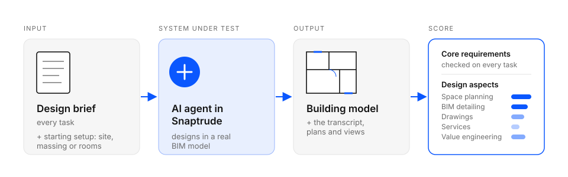
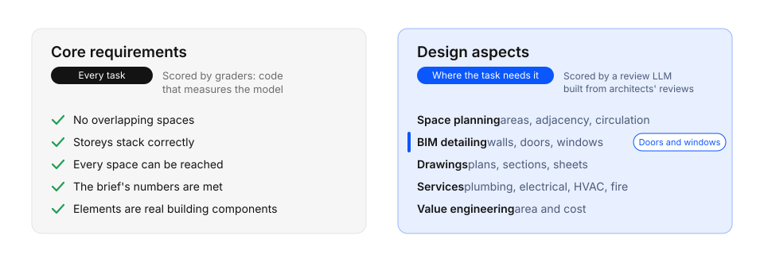
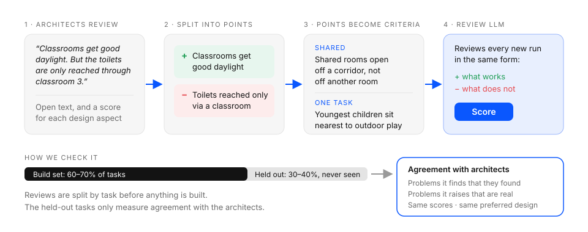

# AECBench

AECBench measures AI on real architectural work. Each part of the benchmark tests one kind of work on real building models, and is scored by a reviewer that we tune against architects' reviews.

## How AECBench is made

AECBench gives an AI agent the same kind of brief that an architect gets from a client. The agent designs in Snaptrude, a real BIM tool, and we score the building that it makes.



**Every task starts from a brief.** Each task is a normal piece of architectural work, for example *"Design a four-storey kindergarten"* or *"Add doors and windows to this hotel."* Some tasks also start from a site, a massing or a set of rooms.

**Two kinds of checks.** Design work has no single correct answer, so a pass or fail test alone cannot grade it. We check each building in two ways:



- **Core requirements, on every task.** Code reads the model and measures facts: rooms do not overlap, floors stack correctly, people can reach every space, and the numbers in the brief are met. Each check passes or fails, with the measured value next to the expected value.
- **Design aspects, where the task needs them.** A review LLM judges the design the way an architect does. It writes what works, what does not, and a score.

**A reviewer built from architects' reviews.**



1. Architects review the agent's work in their own words and give a score.
2. We split each review into single points, positive or negative.
3. Points that repeat across many tasks become shared criteria. Points that apply to only one brief become that task's rubric.
4. The review LLM uses these criteria to review every new run, in the same form as the architects.

We split the reviews by task before we build anything. We use 60–70% of the tasks to build the criteria, and keep the other 30–40% hidden. We use the hidden tasks only to measure how closely the review LLM agrees with the architects. Each part's README shows this agreement for its own reviewer.

## Parts

| Part | What it tests | Cases | Status |
| --- | --- | --- | --- |
| [Doors and windows](parts/doors-windows/) | Place every door and window in a whole building | 20 | Live, v1.0 |

More parts are coming. We release something new every week: new criteria for the parts that are here, and new parts of the benchmark. See [`CHANGELOG.md`](CHANGELOG.md).

Read more: [AECBench: measuring AI on real architectural work](https://www.snaptrude.com/blog/aecbench-measuring-ai-on-real-architectural-work).

## How this repository is organised

```text
parts/<part>/
  README.md        what the part tests, its criteria, cases and results
  criteria.json    every criterion: id, version it was added in, status
  cases/<case>/    one folder per building; case IDs never change
  results/<date>_v<version>/   one folder per run; never edited after release
  review/          the standard and instructions that the reviewer uses
```

## Take part

- **Disagree with a score?** Open a [score dispute](../../issues/new?template=dispute-score.yml).
- **Have a building we should test?** [Propose a case](../../issues/new?template=propose-case.yml).
- **Something we should check?** [Propose a criterion](../../issues/new?template=propose-criterion.yml).

See [`CONTRIBUTING.md`](CONTRIBUTING.md).

## License

Everything in this repository (the buildings, requests, criteria, reviewer standard, scores, review notes and images) is licensed under [Creative Commons Attribution-NonCommercial 4.0 International (CC BY-NC 4.0)](https://creativecommons.org/licenses/by-nc/4.0/). The full text is in [`LICENSE`](LICENSE).

- **You can** share, copy and change the material for research, teaching and other non-commercial use.
- **You must** credit "AECBench by Snaptrude", link to this repository and the license, and say if you changed the material.
- **You cannot** use the material for commercial purposes without written permission from Snaptrude.

The license does not cover the Snaptrude name and logo.
