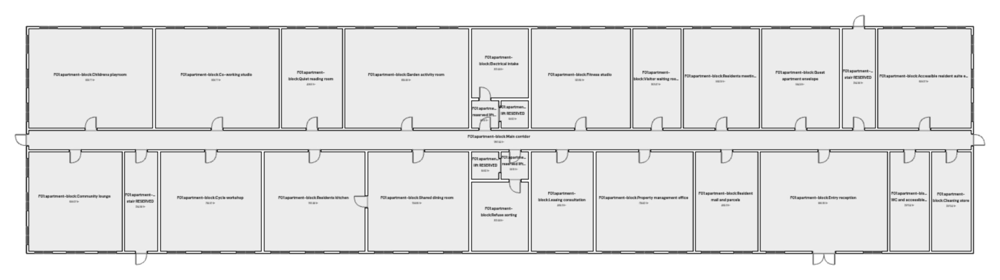

# Apartment block

Case `apartment-block` · Doors and windows v1.0

## 1. The building

- **Type:** Apartment block
- **Floors:** 6
- **Rooms:** 102
- **Start:** Whole-building recorded BIM layout; zero starting openings; reserved vertical cores.
- **Data:** [`building.json`](building.json) has every room, core and access link, in metres. [`case.json`](case.json) lists the known limits of this building.

## 2. The request

> Add doors and windows to this apartment-block.

This is all the agent gets. There is no answer key: no hidden door count, door type or swing.

## 3. What the agent made

- **164 doors** and **350 windows** on 6 floors.

*Ground floor plan of the finished model, in Snaptrude.*

<b>The agent's final message to the user</b>

I added 164 doors and 350 windows to the apartment block (no furniture, since you asked only for openings). Every room on all six floors now has a door, and each habitable room has at least one window. I couldn't get a picture of the result: the view capture failed twice on the canvas side, so open the 3D view to see the facades.

**Doors (164)**
- **Ground floor (33):**
  - The main entrance is a 1.83 m double door in the south wall of Entry reception, opening outward.
  - Each stair has an exit door straight to the outside, and each end of the corridor has one too.
  - The Residents kitchen has a direct door into the Shared dining room.
- **Upper floors (26–27 each):** every apartment, shared room and store has one 0.91 m door from the main corridor. On floor 6 the Celebration kitchen also connects to the Community dining room.
- **Lift core:** each lift lobby has a door from the corridor. The lifts have 1.2 m sliding landing doors onto their lobbies. The refuse, plant and riser rooms behind the lifts are reached from the lobbies.
- **Stairs:** the doors into both stairs are rated 60 minutes and open into the stair, the way people leave.
- **What I fixed:** 18 small doors (stores, plant rooms and the east-stair doors) were hinged on the wrong side. I flipped them so each opens back against the wall beside it.

**Windows (350)**
- Double-hung, 1.5 m wide.
- Ground floor: 2.1 m tall with a 0.6 m sill. Floors 2–6: 1.5 m tall with a 0.9 m sill.
- On a typical 8.4 m frontage that's three windows, about 1/10 of the floor area as glass.
- Floors 2–6 also get a 1.0 m window at each end of the corridor.
- No windows in the stairs, lifts, stores, refuse rooms, plant rooms or the public WC.

**CA – circulation and access**
- **Corridor — met:** a central double-loaded corridor with labelled lift lobbies. Both stairs and the lift core open off it on every floor. The main entrance is in the south wall of Entry reception, which opens onto the corridor.
- **Access — partly met:**
  - The access check reports "fail", for one reason: the floors aren't linked.
  - On the ground floor, all 28 of 28 rooms are reachable. All 163 rooms have a door and none is unreachable.
  - The 135 rooms on floors 2–6 can't be linked to the ground, because the stair and lift rooms are only reserved spaces with no stairs in them yet. Each of those rooms does have its door off the corridor or a lift lobby.
  - No room is reached only through another room.
- **Daylight — met:** all 101 habitable rooms sit on an outside wall with a window. None is internal.
- **Corridor width — not verified:** the corridor is 1.8 m between wall centrelines (likely about 1.5 m clear, against the 1.1 m minimum). I didn't measure the clear width. There are no columns or furniture in it.
- **Dead ends — not met without sprinklers:** on floors 2–6 the corridor runs about 9.5 m past each stair door to the end wall. That's within the 15 m allowed with sprinklers, but over the 6 m limit without them. Which applies is your call.
- **Toilets — partly verified:** the ground-floor Public WC and accessible WC is entered from the corridor. Whether each sex has its own direct entry isn't verified, because the cubicles inside aren't modelled.
- **Service rooms — met:** all of them are reached from the corridor or a lift lobby, never through a stair or another room.
- **Exits — met:** there are two stairs on every floor, about 60 m apart against a 40.6 m half-diagonal. Each discharges straight outside at ground level.
- **Doors — met:**
  - 164 placed, and I read the swing on all of them.
  - No door opens into the corridor.
  - 5 open outward as exit doors: the main entrance, the two stair exits and the two corridor-end exits.
  - 18 had their hinges flipped.
- **Open findings — none new.**
- **Furniture (step 7):** not counted, since only openings were asked for.
- **Model check:** no problems with the new doors or windows. It still reports the missing stairs between floors (5 findings), which were already flagged before this work.

**BA – BIM authoring**
- **Element types — met:** all openings are real door and window elements (164 doors, 350 windows). No masses were used in place of any.
- **Openings — met:**
  - One door batch and one window batch per floor, with nothing refused.
  - 163 of 163 rooms have a door.
  - 101 of 101 habitable rooms have an outside window.
  - No doors open into the corridor and no habitable room is without a window.
- **Overlaps — met:** the overlap check on floors 1–6 (doors and windows against each other and against columns) passed with 0 clashes and 0 duplicates. Access is as in the access item above.
- **Not part of this work:** no walls, partitions, slab openings, structure, roof or furniture.

**Next steps**
1. Put stairs in the West and East stair cores, with openings cut through the slabs. Then the floors are linked and the access check can follow a route from the street to every apartment.
2. Lay out the inside of the apartments (bedrooms, bathrooms, kitchens). They're single open shells now, so each has one entrance door and its windows.
3. Apply facade, glazing and floor finishes, then show the block in Realistic view.

## 4. The review

**Score: 9 / 10**

The opening work is comprehensive and coherent across all six occupied storeys: 164 doors and 350 windows were measured, every one of 163 rooms has a door, and all habitable room uses inspected have exterior windows. All 514 openings are hosted and contained within their walls, door bottoms are at floor level, door swing/hinge checks found no defects, and the lift, stair, exit, and entrance openings meet the applicable operation and nominal-width rules. Minor reservations are the uniformly low 0.594 m ground-floor window sill—including offices and consultation rooms—and the fact that moving-leaf collision sweeps and some instance-level family parameters could not be independently assessed.

**Problems left that the automatic checks found:** 0

### What was right

- Complete opening coverage on every occupied storey, not merely the ground floor.
- All 163 rooms have at least one door; no isolated or doorless occupied rooms were found.
- Habitable apartment envelopes, offices, studios, lounges, dining rooms, workspaces, and similar uses all have exterior windows.
- All 514 openings have wall hosts and fit within their host bounding boxes; every door bottom measured exactly at its host-wall base.
- Consistent upper-floor window geometry: 0.894 m sills, 2.406 m heads, and 1.513 m heights on storeys 2–6.
- Opening measurements found no room doors swinging into circulation and no hinge-return failures.
- Lift landing doors are sliding and nominally 1.20 m wide; stair and exit doors are nominally 1.029 m wide; the main entrance is a 1.943 m double-swing opening.
- Family inventory includes Single Flush Door v4, Pair Flush Door v5, Lift Landing Door v1, and Double-Hung Window v6 definitions appropriate to the principal functions.
- The delivered counts exactly match the agent’s headline claim of 164 doors and 350 windows.

### What was wrong

- Every ground-floor window has a 0.594 m sill, including the property-management office, leasing consultation, co-working studio, and reading room; this is lower than the standard’s typical 0.9–1.0 m office sill guidance.
- Moving-leaf and sash collision sweeps against nearby walls or fixtures were not independently assessable from the available facts.
- The access check reports the upper floors as not linked to other floors, but this is not penalized because the starting model explicitly contains reserved stair/lift zones rather than physical vertical circulation.
- The agent’s prose calls typical upper-floor room doors “0.91 m,” while the measurements show 1.029 m nominal openings; this is plausibly a leaf-versus-opening convention and is treated as imprecise reporting rather than fabrication.

### Measured evidence

Live measurements found storey counts of 33/52, 26/59, 26/63, 26/56, 26/58, and 27/62 doors/windows, totaling 164 doors and 350 windows. The access check measured 163 rooms with doors and no doorless rooms; host checks measured 0 unhosted and 0 outside-host openings. Ground-floor window sills measured 0.594 m, while storeys 2–6 measured 0.894 m; the agent claimed, “Every room on all six floors now has a door, and each habitable room has at least one window.”

The full review is in [`results/2026-11-15_v1.0/reviews/apartment-block.json`](../../results/2026-11-15_v1.0/reviews/apartment-block.json).

## 5. Self-fixes

The agent ran the automatic checks while it worked, and fixed what they found.

| Check | Found at first check | Left at last check |
| --- | --- | --- |
| Door opens against a wall | 18 | 0 |

---

Disagree with this score? [Open a score dispute](../../../../../../issues/new?template=dispute-score.yml).
