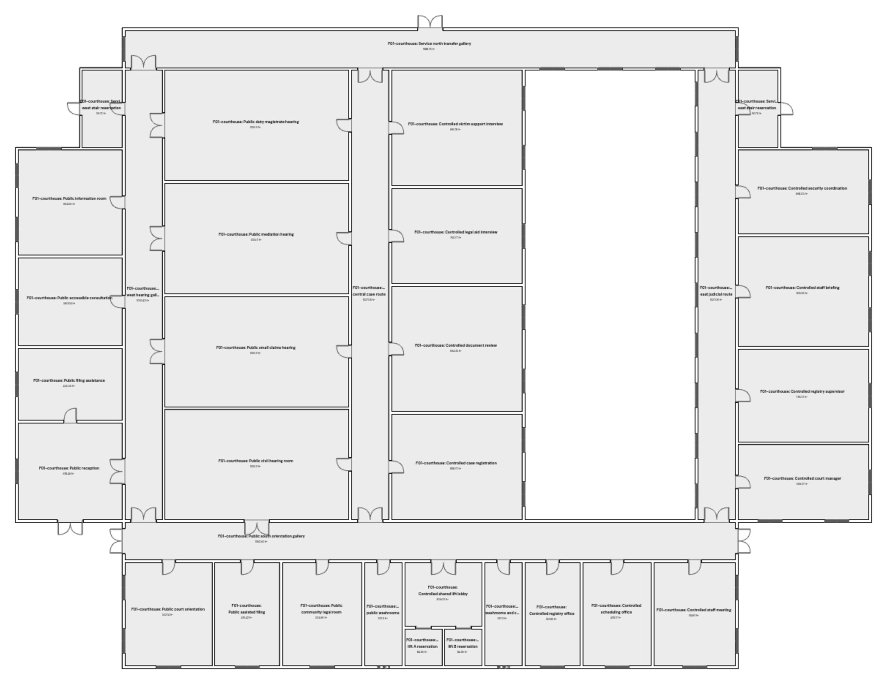

# Courthouse

Case `courthouse` · Doors and windows v1.0

## 1. The building

- **Type:** Courthouse
- **Floors:** 4
- **Rooms:** 88
- **Start:** Whole-building recorded BIM layout; zero starting openings; reserved vertical cores.
- **Data:** [`building.json`](building.json) has every room, core and access link, in metres. [`case.json`](case.json) lists the known limits of this building.

## 2. The request

> Add doors and windows to this courthouse.

This is all the agent gets. There is no answer key: no hidden door count, door type or swing.

## 3. What the agent made

- **162 doors** and **244 windows** on 4 floors.

*Ground floor plan of the finished model, in Snaptrude.*

<b>The agent's final message to the user</b>

I've added doors and windows to all four floors of the courthouse: **162 doors and 244 windows**. No rooms are furnished: you asked only for openings, and the model had no furniture before. The two stair rooms are still empty too, also as before.

**Doors**
- **Ground floor entrances:**
  - a 6'-0" double door into Public reception as the main public entrance
  - a public entrance at the west end of the south orientation gallery
  - a staff and judicial entrance at its east end
  - a service entrance on the north transfer gallery
- **Rooms:** every room has a 3'-0" door from its corridor. Public rooms open off the public galleries and controlled rooms off the central and east routes. Room doors swing into the room.
- **Courtrooms and hearing rooms (16):** each has a public 6'-0" double door from the public gallery and a judicial 3'-0" door from the controlled central route.
- **Corridors:** every pair of corridors that meet (galleries, routes, lift lobby, reception) is joined by a double door.
- **Stairs:** both stair rooms have 60-minute fire-rated doors on every floor. On the ground floor each also has an exit door straight outside.
- **Lifts:** both lifts have 1.2 m centre-opening landing doors off the lift lobby on every floor.

**Windows**
- All rooms with an outside wall, and the ends of the galleries, have fixed 2-panel windows, 6'-0" × 7'-0" on a 3'-0" sill, about one per 12 ft of wall.
- The washrooms have one high 3'-0" × 3'-0" window each, on a 6'-6" sill.

**Fixes I made**
- I flipped 8 corridor-link doors that swung the wrong way.
- I moved the hinge to the other side on 4 staff washroom doors.

**Left as is, on purpose:** the 16 courtroom public double doors open outward into the gallery. Each courtroom holds more than 50 people (about 82 at assembly density), and code requires those exit doors to swing in the direction people leave.

**CA – Circulation and access** (the model already had walls; I checked the doors on it)
- **Spine:** met. Galleries and routes wrap around rooms on both sides, all drawn as labelled spaces. Both stair rooms and the lift lobby open off them. The main entrance is on the south side, into Public reception.
- **Access:** not met.
  - Ground floor: 34 of 34 rooms reachable, 0 without a door, 0 unreachable.
  - Floors 2–4: the check couldn't evaluate their 102 rooms. It links floors only through stair rooms with identical names, and each name here starts with its floor ("F02-courthouse: …"). There are no dependent rooms.
- **Daylight:** not met.
  - 71 of 71 offices and other day-use rooms have outside windows, and the model check reports 0 rooms missing a window.
  - The 16 courtrooms and hearing rooms are interior with no outside wall. That's pre-existing, and fixing it is a plan decision for you.
- **Widths:** met. Galleries and routes are 9'-2" (2.8 m) clear, against 1.8 m for assembly use (assumed). Nothing stands in a corridor.
- **Dead ends:** not verified. The longest wasn't measured, though all six corridors connect at both ends.
- **Toilets:** partly met. The washrooms open off the south gallery. They're single rooms, so separate men's, women's and accessible entries can't be checked.
- **Routes:** partly met. The public and controlled routes each run continuously, with a separate service entrance. However, the staff washroom and cleaner store open off the public gallery.
- **Egress:** partly met.
  - Two exits on every floor, about 49 m apart against half the plan diagonal of about 40 m.
  - Each stair's ground floor door leads straight outside.
  - Neither stair room has a stair yet, and the model check cannot see stair families, so stair access between floors is unverified.
- **Doors:** 162 placed. I read the swing direction back for all 154 hinged doors, and 12 corrections were applied. 16 open outward by exception: the courtrooms, as above.
- **Open findings:** 16, all the courtroom exits explained above.
- **Furnished (step 7):** 0 rooms furnished.
- **Model check:** 16 doors swinging into a corridor (the courtroom exits). There are no unreachable-room, no-door or blocked-corridor findings, and no doors open onto nothing.

**BA – BIM authoring**
- **Element types:** met. All doors and windows are real door and window elements, with 0 masses standing in for them.
- **Conversion, construction, stale spaces and partitions:** nothing converted or partitioned this time. 0 leftover sketch spaces, and all 432 room edges carry walls.
- **Openings:** met. One door batch and one window batch per floor: floor 1 has 45 doors and 47 windows, floor 2 has 39 and 65, floors 3 and 4 have 39 and 66 each. 0 rooms missing a window and 0 openings that don't fit their wall; the 16 courtroom swings are as above.
- **Checks:**
  - Access: fails because of the floor-name gap above.
  - Clash: not run, so overlaps between doors and windows are not verified.
- **Voids, structure and roof:** not touched.
- **Furniture:** none placed, and 0 open findings.

The 3D view failed to capture, so the only picture I got is a ground floor plan, and it frames only the south row of rooms.

Possible next steps:
1. Place stairs in the two stair rooms, with openings cut through the slabs above.
2. Give the stair and lift rooms one shared name on every floor, so the access check can confirm floors 2–4.
3. Choose how to bring daylight into the courtrooms: skylights over the top floor, or glazing into the galleries.
4. Run a clash check on the new openings.
5. Furnish the courtrooms, offices and washrooms.

## 4. The review

**Score: 7 / 10**

The whole-building opening task is substantially delivered: all 136 rooms have at least one door, all 162 doors and 244 windows are hosted, and coverage is consistent across all four occupied storeys. Rework remains around opening specification and verification: toilet windows are fixed rather than suitable obscured/awning units, moving-leaf clearance was not established, 16 courtroom doors project into galleries, and the stated door dimensions do not match sampled live-model nominal widths.

**Problems left that the automatic checks found:** 16

### What was right

- Complete door coverage on every occupied floor: 34 rooms per storey and no room without a door.
- All 406 openings are associated with wall hosts.
- Lift landing doors are sliding, 1.200 m nominal, and connect lift reservations to the shared lift lobby on each storey.
- No measured door was below 0.8 m; ordinary sampled doors were 1.029 m nominal and courtroom pairs were 1.943 m nominal.
- Doors stand at each storey floor, while window levels are consistent: approximately 0.908 m sills for normal rooms and 1.975 m for washrooms.
- The 16 outward-opening courtroom pairs are consistently arranged and were explicitly disclosed rather than hidden.

### What was wrong

- All 244 windows use a fixed operation; high washroom windows therefore lack the awning/obscured function preferred for toilets.
- The 16 courtroom public pairs open into public galleries. Their assembly-egress rationale is plausible, but leaf-sweep effects on gallery circulation were not measured.
- Moving-leaf and sash clearance was not assessed; the opening check reports estimated leaf positions for the hinged families.
- The access graph confirms ground-floor reachability but reports 102 upper-floor rooms as not linked to other floors. Each has a door, so floor-level coverage is present, but complete building access remained unverified.
- The agent's repeated 3'-0" and 6'-0" door claims differ by more than 5% from sampled nominal widths of 1.029 m and 1.943 m respectively; this was not independently reconciled with a clear-width convention.
- The global duplicate check found zero clashes and zero probable duplicates but remained unverified for 353 geometry pairs, so it does not conclusively establish opening overlap or motion clearance.

### Measured evidence

Live measurements found 45/39/39/39 doors and 47/65/66/66 windows on storeys 1–4, zero unhosted openings, zero rooms without doors, office-window sills at 0.908 m, toilet-window sills at 1.975 m, and eight 1.200 m sliding lift doors. Representative ordinary room doors measure 1.029 m nominal rather than the agent's claimed “3'-0" door,” while courtroom double doors measure 1.943 m nominal; the agent also admits, “Clash: not run, so overlaps between doors and windows are not verified.”

The full review is in [`results/2026-11-15_v1.0/reviews/courthouse.json`](../../results/2026-11-15_v1.0/reviews/courthouse.json).

## 5. Self-fixes

The agent ran the automatic checks while it worked, and fixed what they found.

| Check | Found at first check | Left at last check |
| --- | --- | --- |
| Door does not swing into a corridor | 24 | 16 |
| Door opens against a wall | 4 | 0 |

---

Disagree with this score? [Open a score dispute](../../../../../../issues/new?template=dispute-score.yml).
