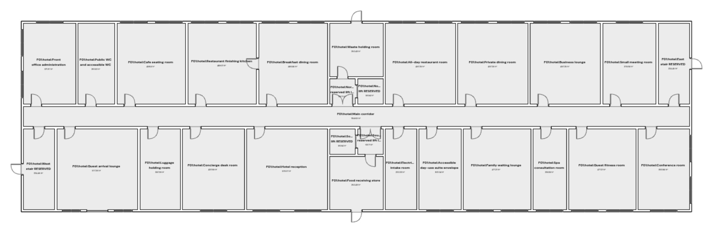

# Hotel

Case `hotel` · Doors and windows v1.0

## 1. The building

- **Type:** Hotel
- **Floors:** 7
- **Rooms:** 119
- **Start:** Whole-building recorded BIM layout; zero starting openings; reserved vertical cores.
- **Data:** [`building.json`](building.json) has every room, core and access link, in metres. [`case.json`](case.json) lists the known limits of this building.

## 2. The request

> Add doors and windows to this hotel.

This is all the agent gets. There is no answer key: no hidden door count, door type or swing.

## 3. What the agent made

- **189 doors** and **210 windows** on 7 floors.

*Ground floor plan of the finished model, in Snaptrude.*

<b>The agent's final message to the user</b>

I've added 189 doors and 210 windows across all seven floors. Every room now has a door off the corridor or a lift lobby. Nothing is furnished yet (guest suites, restaurants, meeting rooms and WCs are all empty), and there are still no stairs in the two "RESERVED" stair rooms.

**What went in**
- **Room doors:** single flush doors, 0.9 m, placed off the main corridor. Each sits about 1.25 m from the same end of its room and swings into the room. Large public rooms on the ground floor (restaurants, lounges, the fitness room) get 1.8 m pair doors.
- **Cores:** each lift lobby opens onto the corridor through a 1.8 m pair door. Each lift has a 1.2 m centre-opening sliding landing door facing its lobby. The rooms behind the cores are entered from the lift lobby, not through another room: the food receiving store and waste holding room on the ground floor, and the room behind each core on the upper floors.
- **Stairs:** a 60‑minute fire-rated door from the corridor into the west and east stair on every floor, opening into the stair (the way people escape). On the ground floor each stair also has a fire-rated exit door straight to the outside, opening outward.
- **Ground floor extras:**
  - A sliding glazed main entrance into the Guest arrival lounge on the south façade, with a window either side.
  - Service entries to the outside from Food receiving and Waste holding.
  - A door from the Restaurant finishing kitchen into the Breakfast dining room.
- **Windows:** fixed two-panel windows on every outside wall of every room people occupy: guest suites, lounges, meeting rooms, dining rooms, offices and the kitchen. One window for about every 3.6 m of façade.
  - Guest rooms: 1.5 × 1.5 m, 0.9 m sill.
  - Ground floor: 2.4 × 2.4 m, 0.6 m sill.
- **No windows:** stairs, lifts, lobbies, corridors, stores, linen and housekeeping rooms, pantries, the electrical room and the WCs.

**Checks**
- **Swings:** I checked every door after placing. None opens into the corridor. I flipped the hinge on 79 doors so that none has its latch side within 1 m of a wall.
- **Lift doors:** the model check found the lift doors were 1.1 m wide. I widened all 14 to 1.2 m and confirmed the new width.
- **Reachability:** all 28 ground-floor rooms can be reached from the entrances. Floors 2–7 can't be tested from the ground yet, because there are no stairs. A fix that would also make that check work is in the next steps.
- **Not run:** a clash check on the new openings.
- **Final view:** the 3D capture failed, so the view shown is the ground-floor plan.

| | Result |
|---|---|
| CA: circulation (CA‑1, CA‑3) | Double-loaded corridor with cores on the corridor; entrance on the south façade into the arrival lounge |
| CA: access (CA‑4) | BIM stage: 190 rooms, 0 without a door; ground floor 28/28 reachable; floors 2–7 not linked (no stairs) |
| CA: daylight (CA‑4c) | Every room people occupy has a window in its outside wall |
| CA: escape (CA‑10) | West and east stairs on every floor, about 57 m apart; on the ground floor both lead straight outside |
| CA: doors (CA‑12) | 189 doors checked: 0 open into the corridor, 79 hinges flipped |
| BA: openings (BA‑6, BA‑7) | 1 door batch and 1 window batch per floor; clash check not run |
| BA: furniture (BA‑11) | Not furnished |
| Model check | Lift door width fixed (14). The 6 missing-stair findings (VC) were there before: the stair rooms are empty |

**Next steps**
- Put a stair in the west and east stair rooms on every floor, with an opening through each slab. This also removes the 6 missing-stair findings.
- Rename the rooms without the per-floor prefixes (F01, F02…) so the same room has the same name on every floor. Then the reachability check can follow the stairs and lifts up and test floors 2–7.
- Run a clash check on the new openings.
- Furnish one guest suite of each type and copy it to the matching suites. Then do the restaurants, meeting rooms and WCs.
- Add glazing and frame finishes to the windows.

## 4. The review

**Score: 8 / 10**

The opening task is comprehensively delivered across all seven occupied floors: every room has a door, all identified habitable uses have exterior windows, and the opening check reports no swing, width, or hosting findings. The main revision is the uniformly low ground-floor sill strategy, especially two Restaurant finishing kitchen windows at 0.594 m where a worktop-compatible sill would normally be about 1.1–1.2 m; moving-leaf clearance was also not assessed.

**Problems left that the automatic checks found:** 0

### What was right

- Complete occupied-storey coverage: floors 1–7 contain respectively 33/26/26/26/26/26/26 doors and 30/27/28/33/30/33/29 windows.
- The access check found 190 rooms and zero rooms without a door; floor 1 had 28/28 rooms reachable, while upper-floor linkage was correctly disclosed as outside this opening task because the starting model has reserved stair zones.
- All 210 windows were exterior-facing; none opened into another room or corridor. The only windowless rooms on each floor were circulation, lift/stair reservations, stores, linen/housekeeping, maintenance, electrical, pantry, WC, or waste uses.
- Opening measurements reported no findings across 189 doors and 210 windows. Room doors opened into their rooms, stair doors into the stair reservations, and ground-floor final exits opened outside.
- All 14 lift landing doors were sliding and measured 1.200 m nominal width, matching the agent’s repair claim.
- All 16 stair-related doors used the Single Flush Door family, version 4, and had a 60-minute fire rating.
- Every opening returned a valid host; door bottoms were exactly at their associated floor elevation. Window sills measured 0.594–0.894 m.
- The family choices were coherent: single flush room/stair doors, pair flush doors for larger public rooms, a two-panel sliding main entrance, dedicated centre-opening lift landing doors, and fixed two-panel exterior windows.
- The agent was candid about unassessed items, stating: “Not run: a clash check on the new openings.”

### What was wrong

- Both Restaurant finishing kitchen windows have 0.594 m sills, too low for the standard worktop condition of roughly 1.1–1.2 m unless the kitchen layout deliberately keeps counters away from that façade.
- The same 0.594 m ground-floor sill was applied indiscriminately to office-type rooms including Front office administration, Concierge desk room, and Hotel reception rather than using the standard office range of about 0.9–1.0 m or documenting a deliberate low-glazing design.
- Door-leaf and sash motion sweeps against nearby fixtures and walls were not assessed. This is not treated as a model failure, but prevents a top score.

### Where it breaks the standard

| Rule | What happened | Evidence |
| --- | --- | --- |
| Window sill and head heights must suit room use, including approximately 1.1–1.2 m over a kitchen worktop. | Two large fixed windows were installed in the Restaurant finishing kitchen with 0.594 m sills. | Two windows each had a 0.59365 m sill and 2.4127 m nominal width. |

### Measured evidence

Live measurements found 189 doors and 210 windows, exactly matching the final claim; all 399 openings had wall hosts, all 189 doors stood at floor level, and all 210 windows faced outside. The two windows in “F01:hotel:Restaurant finishing kitchen” measured 0.594 m sill height, while the agent stated: “Ground floor: 2.4 × 2.4 m, 0.6 m sill.”

The full review is in [`results/2026-11-15_v1.0/reviews/hotel.json`](../../results/2026-11-15_v1.0/reviews/hotel.json).

## 5. Self-fixes

The agent ran the automatic checks while it worked, and fixed what they found.

| Check | Found at first check | Left at last check |
| --- | --- | --- |
| Lift doors slide and open onto a lobby | 14 | 0 |

---

Disagree with this score? [Open a score dispute](../../../../../../issues/new?template=dispute-score.yml).
