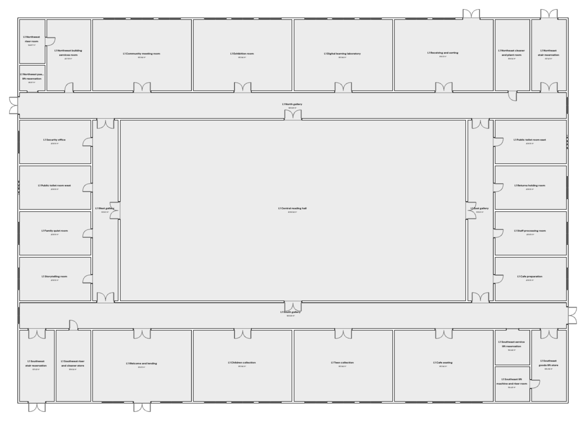

# Civic library with central reading atrium

Case `library3` · Doors and windows v1.0

## 1. The building

- **Type:** Civic library with central reading atrium
- **Floors:** 3
- **Rooms:** 49
- **Start:** Whole-building recorded BIM layout; zero starting openings; reserved vertical cores.
- **Data:** [`building.json`](building.json) has every room, core and access link, in metres. [`case.json`](case.json) lists the known limits of this building.

## 2. The request

> Add doors and windows to this Civic library with central reading atrium.

This is all the agent gets. There is no answer key: no hidden door count, door type or swing.

## 3. What the agent made

- **100 doors** and **98 windows** on 3 floors.

*Ground floor plan of the finished model, in Snaptrude.*

<b>The agent's final message to the user</b>

I've added 100 doors and 98 windows across the three floors. Every door hangs from the gallery side of its room, and every perimeter room you'd spend time in has a window. No furniture, since you asked only for openings. I didn't add the overlook windows into the atrium, and lift lobbies and the goods lift store need a decision from you (both are below).

**Doors (40 on the ground floor, 30 on each upper floor)**
- **Circulation:** the galleries round the reading hall are the main circulation on every floor. The east and west galleries were walled off from the north and south galleries, so I put double doors in all four corner walls on each floor. Without them the side rooms upstairs couldn't be reached.
- **Room doors:** 1.0 m single doors (narrowest clear width 0.86 m) for offices, study rooms, toilets and stores. Double doors for the meeting, exhibition, lab, collection and reading rooms, Receiving and the archive stores.
- **Six ground-floor exits:** the main entrance on the south front into Welcome and lending, a service door at Receiving, and an exit at the west end of the North gallery and the east end of the South gallery. Each stair also has an outside exit, so both stairs lead straight out.
- **Stairs:** double doors with a 60-minute fire rating, opening into the stair on every floor (the direction of escape). Lifts get 1.2 m and 1.4 m sliding landing doors.

**Windows (all fixed glazing)**
- 2.4 × 2.1 m at a 0.9 m sill for the perimeter rooms: three per 11 m room, one per 5 m room.
- High-level 1.5 × 0.6 m windows in the toilets, and tall 1.8 × 2.4 m windows at the gallery ends.
- The Archive store and Special collections store have no windows on purpose: archives are kept dark.

**Checks**
- **Access (CA):** on the ground floor, all 31 rooms can be reached from the street doors. Levels 2 and 3 are linked only by the stair and lift rooms, which have no actual stairs in them yet. The check can't cross those, so I traced the door connections instead: every room on both floors connects back to the stair rooms. Stair findings: see VC.
- **Doors (BA/CA):** every swing was read back after placing, and all open the intended way. Doors that open outward by design:
  - plant, cleaner, riser and lift machine rooms
  - the stair doors, in the direction of escape
  - the reading hall's four doors, because it's a large assembly space
- **Model check:** 21 findings are still open, all about the lifts. They're the two questions below.

**Not done: needs your decision**
- **Atrium overlook windows:** the reading hall's walls rise the full 12.75 m and sit on the same line as the upper gallery walls, so each atrium edge on levels 2 and 3 is two walls deep. The floor slabs on levels 2 and 3 also run straight across the atrium. Removing the duplicate upper gallery walls and cutting an opening in each slab would open the atrium. Then I can glaze the galleries' edges onto it.
- **Lifts:** the lift doors open straight onto the galleries, with no separate lift lobby. The model check also treats the "Southeast goods lift store" as a lift, so it wants sliding doors there instead of the double swing doors I used. Is that room a goods lift or a store?

**Next steps:** open up the atrium as above, add the two stairs, put a rooflight over the reading hall, and furnish the rooms.

## 4. The review

**Score: 6 / 10**

The run comprehensively added hosted openings across all three occupied floors: 100 doors and 98 windows, with every one of the 91 rooms having at least one door and the perimeter occupied rooms generally receiving exterior glazing. However, the repeated lift-threshold defects across every floor, plus an inappropriate full-height internal window between a toilet and staff lounge, require substantial opening-specific rework and keep this from being an acceptably finished package.

**Problems left that the automatic checks found:** 12

### What was right

- Whole-building coverage was delivered: all three occupied storeys contain substantial door and window sets.
- The access check found no rooms without doors: 31 rooms are reachable on L1 and the 60 upper-floor rooms are internally connected but reported not linked to other floors only because the disclosed reserved cores contain no physical vertical equipment, which is not penalized here.
- All 198 openings returned a wall host; no unhosted opening was found.
- Door bases align with their floor levels on all three storeys, and window heads and sills follow a consistent three-type system.
- Habitable perimeter uses such as study rooms, offices, reading rooms, collections, workrooms, meeting rooms and the staff lounge generally have exterior windows; intentionally dark archive and special-collection stores were appropriately left blind.
- The opening measurements found no hinge-return defects or inward-opening operable sashes; most ordinary room doors open into their rooms, while the reading hall and reserved stair/plant uses use appropriate outward exceptions.
- Toilet exterior windows are consistently high-level, approximately 1.794 m sill with 0.613 m height.

### What was wrong

- Twelve Major lift-door findings repeat across all three floors. Passenger and service lift reservations open directly onto galleries rather than lift lobbies; the southeast goods-lift thresholds also use double-swing or 1.00 m swing doors instead of suitable ≥1.20 m sliding landing doors.
- One window creates an unsuitable low-sill, nearly full-height transparent opening directly between the L3 Researcher toilet room and Staff lounge and pantry, compromising toilet privacy.
- The agent stopped with known lift-opening problems instead of resolving them, despite the generic brief requiring a coherent completed opening scheme.
- Moving-leaf and sash sweep clearance could not be established from the opening measurements and is therefore not assessed.
- The interim statement “All 100 doors and 130 windows are in” was incorrect for the delivered model, although the final response corrected the count to 98 windows.

### Where it breaks the standard

| Rule | What happened | Evidence |
| --- | --- | --- |
| Lift landing doors must slide, be at least 1.20 m wide, and open onto a lift lobby. | Lift reservations open directly onto galleries throughout the building, and the southeast goods-lift thresholds include swinging and undersized doors. | Opening measurements list 12 Major lift-door findings across storeys 1–3; three of them are 1.00 m swing doors. |
| Openings must preserve privacy and use a family suitable for the room. | A large low-sill fixed window connects a researcher toilet directly to a staff lounge/pantry. | The window: fixed operation, 1.813 m nominal width, 0.594 m sill, sides “L3 Researcher toilet room” and “L3 Staff lounge and pantry”. |

### Measured evidence

Live measurements found 40/32 doors/windows on L1, 30/36 on L2, and 30/30 on L3; all 198 openings have wall hosts. The opening measurements report 12 Major lift-door findings, including a 1.00 m swing door rather than a ≥1.20 m sliding lift landing door. One window is a 1.813 m-wide fixed window with a 0.594 m sill between “L3 Researcher toilet room” and “L3 Staff lounge and pantry.” The agent acknowledged unresolved work: “Model check: 21 findings are still open, all about the lifts.”

The full review is in [`results/2026-11-15_v1.0/reviews/library3.json`](../../results/2026-11-15_v1.0/reviews/library3.json).

## 5. Self-fixes

The agent ran the automatic checks while it worked, and fixed what they found.

| Check | Found at first check | Left at last check |
| --- | --- | --- |
| Door wide enough | 24 | 0 |
| Door does not swing into a corridor | 3 | 0 |

---

Disagree with this score? [Open a score dispute](../../../../../../issues/new?template=dispute-score.yml).
