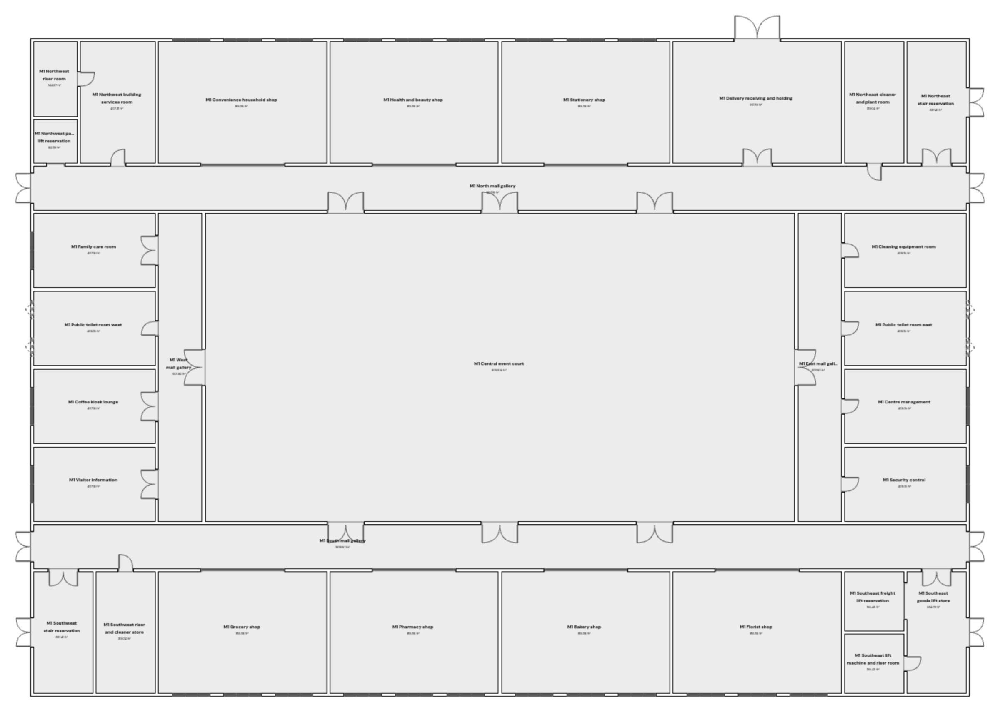

# Four-level retail and leisure centre

Case `mall4` · Doors and windows v1.0

## 1. The building

- **Type:** Four-level retail and leisure centre
- **Floors:** 4
- **Rooms:** 65
- **Start:** Whole-building recorded BIM layout; zero starting openings; reserved vertical cores.
- **Data:** [`building.json`](building.json) has every room, core and access link, in metres. [`case.json`](case.json) lists the known limits of this building.

## 2. The request

> Add doors and windows to this Four-level neighbourhood retail and leisure centre.

This is all the agent gets. There is no answer key: no hidden door count, door type or swing.

## 3. What the agent made

- **120 doors** and **140 windows** on 4 floors.

*Ground floor plan of the finished model, in Snaptrude.*

<b>The agent's final message to the user</b>

I've added **120 doors and 140 windows** across all four floors. Every swinging door opens the intended way. Rooms are not furnished, since you asked for openings only. The plan stays as it was: no walls or rooms were moved.

| Floor | Doors | Windows |
|---|---|---|
| Ground | 42 | 30 |
| Fashion and accessories | 26 | 37 |
| Home technology and leisure | 26 | 37 |
| Food and leisure | 26 | 36 |

**Doors**
- **Main entrances:** four 6'-7" (2.0 m) glazed double doors at the ends of the north and south galleries, opening outward.
- **Other outside doors on the ground floor:** an exit door from each stair, a 9'-10" (3.0 m) goods door into Delivery receiving and holding, and a service door into the southeast goods-lift store.
- **Large shops, restaurants and lounges:** a 17'-9" (5.4 m) automatic sliding front onto the gallery.
- **Smaller units:** 6'-0" × 7'-0" double doors for the side shops, workshops, collection rooms, stockrooms, the goods-lift store and catering. Offices, toilets, the rest room and the wash-up room get 3'-3" (1.0 m) single doors.
- **Opening into the room:** room doors swing into their rooms. I flipped 17 doors so they do, 12 of them on the ground floor.
- **Opening outward, as exceptions:** the central event court has 8 doors of 7'-10" (2.4 m) opening out, because it's an assembly space. Risers, the plant/cleaner rooms and the lift machine room also open out.
- **Stairs:** 60-minute fire-rated double doors from the gallery on every floor.
- **Lifts:** sliding landing doors. The passenger lift opens onto the north gallery; the freight lift opens into the goods-lift store.

**Windows**
- **Large units:** three 7'-10" × 7'-10" (2.4 × 2.4 m) shop windows each, on a 2'-0" sill.
- **Side rooms:** one 7'-10" × 6'-11" window each, on a 3'-0" sill.
- **Toilets:** two high-level vent windows each, with a 5'-11" sill.
- **Galleries:** windows at each end of the north and south galleries on the upper floors.
- **No windows:** stores, plant rooms, risers, lifts, stairs and Delivery receiving.

**Checks — CA (circulation and access)**
- **Spine:** met. The ring of mall galleries is the circulation, and the stair and lift cores sit on it. The four entrances lead straight into the galleries; there's no separate entrance lobby, which is the existing plan.
- **Access:** the access check fails. All 31 of 31 ground-floor rooms are reachable from the entrances, and 0 rooms have no door. The 90 upper-floor rooms can't be linked to the ground: the stair rooms are empty, and each floor's room names carry a floor prefix (M1, M2…), so the check can't stack them.
- **Daylight:** every occupied room on an outside wall has a window, and the model check shows 0 rooms missing one. The central event court has no outside wall, so it has no daylight; a rooflight would fix that.
- **Widths: not met.** The galleries are 9'-2" (2.8 m) between walls, against 3 m for a mall concourse. This is the existing plan; widening them would mean moving walls.
- **Dead ends:** met. Every gallery leads to an entrance or another gallery.
- **Toilets: not met.** Each toilet block is one room opening straight off the gallery, with no toilet lobby and no separate men's and women's rooms. This is the existing plan.
- **Routes:** met. Delivery receiving and the goods-lift store both have outside service doors, and every service room has a door.
- **Egress:** the two stair rooms are about 215 ft (65.5 m) apart, more than half the plan diagonal (36.7 m). Each has an outside door on the ground floor, but the stairs themselves aren't modelled yet.
- **Doors:** 120 placed, swing direction read for every swinging door, 17 flipped, 32 opening outward by the exceptions above.
- **Findings left:** 26, all about lift doors; see the model check note below.
- **Finished (step 7): not met.** No rooms are furnished; this request was for openings only.

**Checks — BA (BIM authoring)**
- **Element types:** met. All openings are real door and window families, with no masses standing in.
- **Openings:** each floor's doors and windows went in as one batch each. The ground-floor doors needed two attempts: the first was refused because the lift-door families hit the lift floor, so I swapped in lift door families that fit.
- **Clash:** not run as a separate check. Every door and window passed the fit and clearance test when it was placed.
- **Furniture:** not part of this request; no rooms are furnished.
- **Not applicable this turn:** conversion, wall types, partitions, slab openings, structure, roof.

**Model check note:** 26 lift-door findings remain. Most are triggered only because the names "goods lift store" and "lift machine and riser room" contain "lift". Those rooms are a store and a plant room, so swing doors are right there. The rest are real: the lifts open onto the gallery and into the goods store rather than into a dedicated lift lobby. Fixing that means changing the plan, so I've left it for you to decide.

**Next steps**
1. Add lift lobbies in front of the passenger and freight lifts.
2. Place the stairs in the southwest and northeast stair rooms.
3. Cut a rooflight over the central event court.
4. Add a toilet lobby and partitions inside each toilet block, then fit it out.
5. Apply finishes, such as clear glazing and frame colours.

I couldn't get a 3D view of the finished building; only a partial ground-floor plan came through.

## 4. The review

**Score: 6 / 10**

The opening task is substantially delivered across all four occupied floors: the live model contains exactly 120 doors and 140 windows, every one has a wall host, and the access check reports no doorless rooms. However, the actual passenger and freight lift landing arrangements repeatedly open directly to galleries or a goods-store room rather than a lift lobby, creating several Major findings and requiring real rework before acceptance.

**Problems left that the automatic checks found:** 17

### What was right

- Complete whole-building coverage: Ground has 31/31 rooms with doors, and each upper floor has 30/30 rooms with doors.
- The claimed total of 120 doors and 140 windows exactly matches the live model; the floor-by-floor counts also match.
- All 260 openings returned a valid wall host; no unhosted opening was found.
- Exterior-window coverage is extensive on every floor, including retail units, offices/workshops, restaurants, lounges and activity spaces; toilets consistently receive two high-level windows.
- Measured window placement is use-appropriate: office/family-care sills are about 0.89 m, most retail glazing is about 0.59 m, and toilet windows are about 1.79 m above their floor level.
- Door widths are generally suitable: the measured minimum nominal door width is 1.00 m and minimum readable clear width is 0.86 m.
- The opening check reported no general wrong-swing, hinge-return or undersized-room-door findings outside the lift classification issues.
- Upper-floor access failure is solely storey-linking through the disclosed empty stair reservations; it is not counted against this opening-only run.

### What was wrong

- Passenger lift doors on all four floors open directly onto the north mall gallery instead of a lift lobby.
- Freight lift landing doors similarly connect the lift reservation to the “Southeast goods lift store,” which is a room rather than a dedicated lift lobby.
- The agent left these Major lift-threshold issues unresolved after its checks, explaining that lobbies would require plan changes rather than delivering a compliant opening arrangement.
- Exact catalogue definitions for representative families could not be resolved during review, so detailed family-function fitness and moving-leaf collision sweeps are not assessed.

### Where it breaks the standard

| Rule | What happened | Evidence |
| --- | --- | --- |
| A lift landing door must be sliding or bare, at least 1.20 m wide, and open onto a lift lobby rather than a corridor or room. | Although the actual passenger landing doors are sliding and 1.20 m wide, they open directly onto mall galleries on all four floors; freight lift doors open into a goods-store room. | Measurements for one passenger lift door: operation sliding, nominal width 1.20 m, sides “M1 Northwest passenger lift reservation” and “M1 North mall gallery.” Equivalent passenger-lift findings occur on storeys 2–4, while four doors connect freight reservations to goods-lift stores. |

### Measured evidence

Live measurements found floor-by-floor opening counts of 42/30, 26/37, 26/37 and 26/36 doors/windows; the access check found 121 rooms and 0 without doors. One example is a 1.20 m sliding passenger-lift door between “M1 Northwest passenger lift reservation” and “M1 North mall gallery,” not a lift lobby; the agent also acknowledged, “the lifts open onto the gallery and into the goods store rather than into a dedicated lift lobby.”

The full review is in [`results/2026-11-15_v1.0/reviews/mall4.json`](../../results/2026-11-15_v1.0/reviews/mall4.json).

## 5. Self-fixes

The agent's checks found no door problems to fix while it worked.

---

Disagree with this score? [Open a score dispute](../../../../../../issues/new?template=dispute-score.yml).
