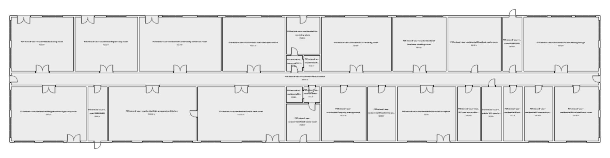

# Mixed-use residential

Case `mixed-use-residential` · Doors and windows v1.0

## 1. The building

- **Type:** Mixed-use residential
- **Floors:** 6
- **Rooms:** 102
- **Start:** Whole-building recorded BIM layout; zero starting openings; reserved vertical cores.
- **Data:** [`building.json`](building.json) has every room, core and access link, in metres. [`case.json`](case.json) lists the known limits of this building.

## 2. The request

> Add doors and windows to this mixed-use-residential.

This is all the agent gets. There is no answer key: no hidden door count, door type or swing.

## 3. What the agent made

- **173 doors** and **246 windows** on 6 floors.

*Ground floor plan of the finished model, in Snaptrude.*

<b>The agent's final message to the user</b>

**Not furnished:** none of the rooms have furniture or fixtures yet. This pass added only doors and windows.

I added **173 doors and 246 windows** across all six floors. Every room has a door, every placement landed, and the doors and windows don't collide with each other on any floor.

**Doors**
- **Every room:** one door from the main corridor, opening into the room. The 12 small rooms in the middle of the plan have no corridor wall: the 4 lift lobbies have doors to the corridor, and each storey's 2 lift shafts and 2 service rooms (waste, goods-in, water and so on) open off those lobbies.
- **Sizes:** rooms of 60 m² or more get double doors, 6'-0" × 7'-0". Homes, offices and service rooms get 3'-0" × 7'-0" single doors.
- **Stairs:** the doors into both stair rooms are 60-minute fire doors on every floor. On the ground floor each stair also has a fire exit straight outside.
- **Lifts:** 12 sliding lift doors, 1200 mm wide, open from the lift lobbies.
- **Ground floor:**
  - Double street doors for the grocery, café, bookshop, repair shop and exhibition room.
  - Double doors into the residential reception as the main residential entrance.
  - Single doors at both ends of the corridor.
  - Service doors into goods-in and the retail waste room, so goods and waste don't pass through the shops.
- **Kitchen to dining:** a door joins the café kitchen and the café. On the upper floors the plan put no kitchen next to a dining room, so none got this door.
- **Fix made:** 20 doors were hinged on the wrong side, so the open door stood out in the room. I moved their hinges so they open back against the wall.

**Windows**
- **Ground floor:** tall fixed shopfront glazing, 9'-4" wide × 7'-10" high, about 1'-0" off the floor. The street doors sit near one end of each frontage so the glazing still fits.
- **Upper-floor shared and work rooms:** wide fixed windows, 9'-4" × 4'-0", 3'-0" sill.
- **Homes:** opening double-hung windows, 5'-0" × 3'-10", spaced about one per 10 ft of outside wall.
- **Corridor ends (upper floors):** a narrow window at each end.
- **No windows:** stairs, lifts, WCs, stores, plant rooms, the cycle room and the parcel room.

**CA — Circulation and access (walls and doors in place)**
- **Spine:** met. A 2 m corridor runs the full 84.5 m length of every floor, with lift lobbies off it and both stair rooms on it. The residential entrance opens into the reception, which leads to the corridor.
- **Access:** not met for upper floors. All 28 ground-floor rooms (of 163) are reachable from the street doors, and no room is without a door. Floors 2–6 (135 rooms) can't be checked: the stair rooms are still empty, and each floor names its stair room differently, so nothing links the floors.
- **Rooms entered through another room:** lift shafts and service rooms through their lift lobby; the café kitchen also opens into the café.
- **Daylight:** met. Every room people use has a window on an outside wall.
- **Corridor width:** not verified. It is 2.0 m between wall centres; I didn't measure the clear width between the wall faces. The corridors are empty.
- **Dead ends:** not met as the plan stands. On floors 2–6 the corridor runs about 12.5 m past each stair to a closed end. That is over the usual 6 m limit, though within 15 m if the building has sprinklers. The ground floor has doors at both ends.
- **Toilets:** met. The public WC and the accessible WC are each entered directly from the corridor.
- **Service routes:** met. Goods-in and waste each have an outside door and reach the corridor through a lift lobby.
- **Exits:** two stair rooms per floor, about 60 m apart, against a required minimum of 43 m (half the plan's diagonal). At ground level both stairs open straight outside. But there are no actual stairs yet, so no floor above the ground has a way down.
- **Door swings:**
  - All 173 doors are placed. I checked the 161 swinging doors: none opens into the corridor.
  - 3 open outward on purpose: the two stair exits (escape direction) and the accessible WC (so help can reach someone inside).
- **Unfixed problems:** the empty stairs and the long dead ends above. Both are layout decisions for you.
- **Finished rooms:** 0 rooms have furniture or fixtures.
- **Model check:** no new problems. The 5 "no stair between storeys" warnings were already there; see the stair note above.

**BA — BIM authoring**
- **Element types:** met. 173 doors and 246 windows are real door and window elements; nothing is a placeholder block.
- **Batching:** met. Each floor's doors went in one batch and its windows in a second.
- **Swings and hinges:** checked on 161 doors. None opens into a corridor; 20 hinges were flipped.
- **Collisions:** met. All 419 openings checked floor by floor: 0 collisions and 0 duplicates.
- **Not part of this pass:** walls, partitions, floor openings, structure, roof and furniture were left alone.

**Next steps:**
1. Put real stairs in the West and East stair rooms on every floor, with openings cut through the slabs. That gives the upper floors a way out and lets them be checked.
2. Add lifts to the reserved shafts.
3. Shorten the corridor dead ends, for example with an exit or room at each corridor end, or confirm the building is sprinklered.
4. Fit out the rooms: WCs and basins, kitchens, the café, homes, offices and the childcare rooms.
5. Put glass and frame finishes on the windows, and add canopies over the street entrances.

## 4. The review

**Score: 9 / 10**

The opening package is comprehensive and coherent across all six occupied storeys: 173 doors and 246 windows, every one hosted, no doorless rooms, and no clear daylight omission among ordinary habitable rooms. Door operations, lift doors, widths, sill levels, stair fire ratings, and family choices were appropriately selected; the only reservation is that moving-leaf clearance was not directly established, so this falls short of sign-off without edits or checks.

**Problems left that the automatic checks found:** 0

### What was right

- Complete opening coverage on every occupied floor, not merely the ground floor.
- All 419 doors and windows are hosted in walls; no unhosted opening was found.
- Every one of the 163 rooms has at least one door or valid connection.
- All 246 windows face outside; no window was incorrectly used to borrow light from another room or corridor.
- Habitable residential, workplace, dining, childcare, consulting and shared rooms received exterior windows; rooms without windows were predominantly stairs, lift reservations, service rooms, stores, WCs and lobbies.
- Door nominal widths measured from approximately 1.029 m to 1.943 m, comfortably supporting ordinary rooms, stairs, accessible rooms and major entrances.
- All 12 lift landing doors are sliding, connect reserved lift shafts to lift lobbies, and measure 1.200 m nominal width.
- The stair doors use Single Flush Door version 4 instances with a set 60-minute fire-rating parameter; the sampled ground-floor final stair door was likewise rated.
- The accessible public WC door opens into the corridor as the permitted accessible exception and has a 3'-0" family size.
- Ground storefront windows measured about 2.858 m wide with 0.294 m sills and 2.706 m heads; upper windows had consistent heads and approximately 0.9–0.96 m sills.
- Catalogue choices were functionally suitable, including Pair Flush Door v5, Single Flush Door v4, Lift Landing Door v1, Fixed Window v6 and Double-Hung Window v6.
- The agent's headline count claim, “173 doors and 246 windows,” matches the live whole-model recount exactly.

### What was wrong

- Moving-leaf and sash sweep clearance is not assessed: the measurements showed estimated leaf positions for 161 swinging/double-swing doors, and no independent motion-sweep result was available.
- The agent's broad statement that the openings had “0 collisions” is stronger than the demonstrated evidence because static hosting and opening-rule checks do not prove moving-leaf clearance.
- The plan captures were poorly framed, limiting visual review, although topology, host, operation and dimensional reads supplied the principal evidence.

### Measured evidence

Live measurements found floor-by-floor door/window counts of 40/32, 27/35, 26/43, 27/46, 26/47, and 27/43, totaling 173/246; all 419 openings sit in walls. The access check measured 163 rooms with 0 rooms lacking doors, while upper-window sills measured approximately 0.894–0.960 m and a sampled stair door carried a 60-minute fire rating.

The full review is in [`results/2026-11-15_v1.0/reviews/mixed-use-residential.json`](../../results/2026-11-15_v1.0/reviews/mixed-use-residential.json).

## 5. Self-fixes

The agent ran the automatic checks while it worked, and fixed what they found.

| Check | Found at first check | Left at last check |
| --- | --- | --- |
| Door opens against a wall | 20 | 0 |

---

Disagree with this score? [Open a score dispute](../../../../../../issues/new?template=dispute-score.yml).
