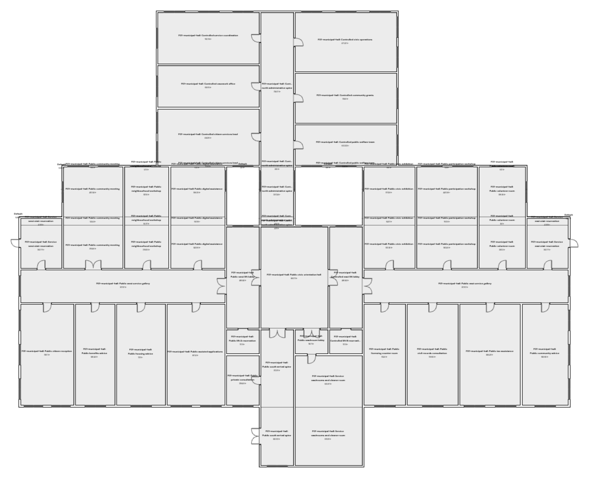

# Municipal hall

Case `municipal-hall` · Doors and windows v1.0

## 1. The building

- **Type:** Municipal hall
- **Floors:** 4
- **Rooms:** 84
- **Start:** Whole-building recorded BIM layout; zero starting openings; reserved vertical cores.
- **Data:** [`building.json`](building.json) has every room, core and access link, in metres. [`case.json`](case.json) lists the known limits of this building.

## 2. The request

> Add doors and windows to this municipal-hall.

This is all the agent gets. There is no answer key: no hidden door count, door type or swing.

## 3. What the agent made

- **134 doors** and **232 windows** on 4 floors.

*Ground floor plan of the finished model, in Snaptrude.*

<b>The agent's final message to the user</b>

Doors and windows are in on all four floors. The ground floor still has damage from my slab repair attempts. You chose to clean that up by hand, and the last two doors and four windows wait for it. Both 3D captures failed (the canvas's graphics stalled), so there's no image here. Please check it on your screen. There's no furniture, since this was a doors-and-windows pass.

**What's in the model**
- **Doors: 134** (ground 35 of 37, then 33 on each upper floor).
  - Offices and meeting rooms get a single flush door (914 mm) on the wall they share with a gallery, spine or lobby.
  - Double doors (1.83 m) go between the hall, spines, lift lobbies and galleries, and on the council chamber and community meeting room.
  - The lifts get 1.2 m centre-opening sliding landing doors.
  - The stair rooms get single doors rated 60 min. On the ground floor each stair also has its own door straight outside.
  - The main entrance is a double door at the south end of the arrival spine.
- **Door swings:** every door was read back after placing. Room doors open into their rooms, stair doors open into the stair (the escape direction) and exit doors open outward. None needed flipping.
- **Windows: 232**, fixed two-panel, 2.4 × 1.8 m with a 0.9 m sill (narrower on short walls). They go on every office and meeting room with an outside wall, plus gallery ends and courtyard sides. Every office and meeting room has at least one.
- **Floor slabs, levels 2–4:** the original slabs had malformed solids, and the door check refused every door that touched them. With your OK I replaced each with 10 rectangular pieces in the same position at the same 152 mm thickness, leaving the two courtyards open. These have new element IDs.

**Ground floor: what went wrong**
- While I was replacing the ground slab, one of my undo steps deleted the original. My attempts to rebuild it were then read as room boundaries.
- About 80 extra boundary lines (no walls on them) now split the floor finishes of the rooms around the courtyards and in the north wing. There are also about 20 small "Default" floor slivers.
- The model check flags **10 stub walls (0.10 m long) on the ground floor**. I haven't deleted them.
  - They sit where the extra lines cross existing walls.
  - Deleting them now would likely leave 0.1 m gaps in those walls.
  - They should disappear when you erase the lines. If any remain afterwards, I'll delete them.
- The new ground slab only reaches about 28 m north of the south edge, up to the courtyards. The north wing has no slab under it.
- **Still to place:**
  - 2 doors: the double door from the north administrative spine to the hall, and the staff entrance at the north end of the spine.
  - 4 windows: two in the north spine's courtyard walls, one in digital assistance, one in civic exhibition.

**Check card**
- **CA:** Every room opens off a gallery, spine or lobby. Single-leaf swings read for 96 doors, 0 wrong. Lifts slide and stair doors open in the escape direction.
  - The access check came back unverified. The ground-floor exits read as opening onto an unconverted sketch room outside.
  - The upper floors don't link to the ground in the check, because the stairs are still empty reservations with no stair families. The checks can't see stair families, so no stair is verified.
  - The washrooms are one shared room behind the washroom lobby, not separate men's, women's and accessible rooms (not met).
- **BA:** Doors are placed per floor in one batch each, windows likewise.
  - The model check finds 10 stub walls, left for your cleanup as explained above.
  - It finds no swing, window or door-placement problems.
  - The 3 missing-stair findings were there before this turn.
- **Open:** the ground-floor items above (2 doors, 4 windows, slab north of the courtyards, split floors, stub walls).

**Next steps**
- Once you've erased the extra ground-floor lines and redrawn the north part of the slab, tell me. I'll remove any stub walls left, place the last 2 doors and 4 windows, and rerun the access check.
- I can place stair families in the two stair reservations so each floor connects to the ground in the access check.
- I can split the ground-floor washrooms into separate men's, women's and accessible rooms off the washroom lobby.

## 4. The review

**Score: 5 / 10**

The run delivered a strong, technically consistent opening set on floors 2–4 and most of the ground floor, but left the ground-floor controlled north administrative wing without either of its intended access doors. Because that use group has six room doors into an otherwise disconnected spine, this is a Blocking access failure under the doors and windows standard and caps the result at 5.

**Problems left that the automatic checks found:** 0

### What was right

- All 366 delivered openings are hosted in walls; no unhosted opening was found on any occupied storey.
- Upper-floor coverage is complete: each of floors 2–4 has 33 doors, no room without a door in the access check, and 59–61 exterior windows.
- All windows read as exterior fixed windows, with consistent approximately 0.894 m sills and 2.706 m heads relative to each storey.
- Door operations and nominal widths suit their roles: ordinary and stair doors are about 1.029 m, double doors about 1.943 m, and lift landing doors are sliding and about 1.200 m wide.
- The opening check reported no shared-rule findings. Room doors open into their rooms, ground exits open outside, and lift doors are non-swinging.
- The main entrance is a 1.943 m double-swing pair, and sampled stair and exit doors use the Single Flush Door family with a 60-minute fire rating.
- The two rooms named as missing one planned window—Digital Assistance and Civic Exhibition—still each have an exterior fixed window, so they are not left without daylight.
- The agent accurately disclosed the incomplete ground-floor openings rather than claiming a fully complete delivery.

### What was wrong

- Ground floor is incomplete by two doors and four windows; the two doors are the consequential omission.
- The controlled north administrative spine has six office doors but no connection to the civic orientation hall or an exterior staff entrance, leaving that entire use group without a usable approach.
- Ground-floor access verification is compromised by the run’s surrounding floor fragmentation: the access check reported the main entrance unresolved against an unconverted sketch room. This was used only as context, not scored as a general architectural defect.
- Moving-leaf collision clearance was not assessable from the opening measurements; many leaf positions were explicitly reported as estimated, and the screenshots failed.

### Where it breaks the standard

| Rule | What happened | Evidence |
| --- | --- | --- |
| Every occupied use group must be enterable through a real door from circulation or outside. | The ground-floor controlled north administrative spine and its six connected rooms have neither the planned hall connection nor the planned staff entrance. | The live opening graph lists six office doors on “F01-municipal-hall: Controlled north administrative spine” but no door to the civic orientation hall or outside. |
| Provide suitable door and window coverage throughout every occupied storey. | Floor 1 remains short by two doors and four planned windows, although the affected habitable rooms still retain at least one exterior window. | Measured floor-1 count is 35 doors and 53 windows; the agent disclosed “ground 35 of 37” and “Still to place…4 windows.” |

### Measured evidence

Live measurements found 134 doors and 232 windows: floor 1 has 35/53, floors 2–4 have 33/59, 33/59, and 33/61. The ground-floor north administrative spine has doors only to six controlled rooms and no door to the civic orientation hall or outside; the agent also explicitly reported: “Still to place: 2 doors: the double door from the north administrative spine to the hall, and the staff entrance at the north end of the spine.”

The full review is in [`results/2026-11-15_v1.0/reviews/municipal-hall.json`](../../results/2026-11-15_v1.0/reviews/municipal-hall.json).

## 5. Self-fixes

The agent's checks found no door problems to fix while it worked.

---

Disagree with this score? [Open a score dispute](../../../../../../issues/new?template=dispute-score.yml).
