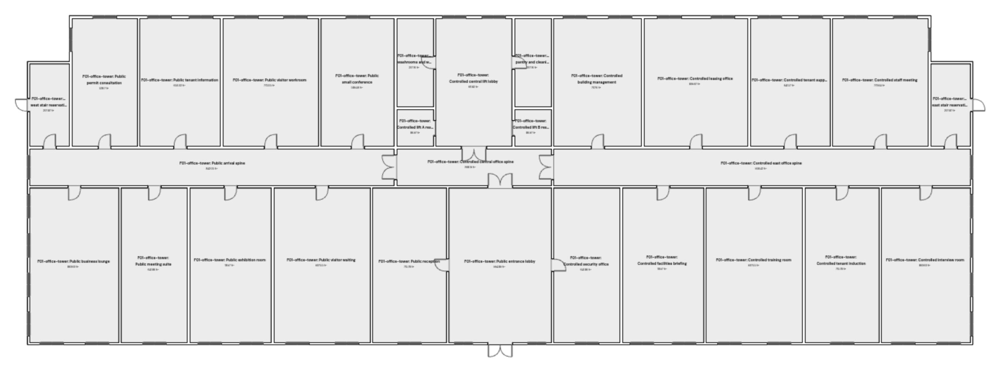

# Office tower

Case `office-tower` · Doors and windows v1.0

## 1. The building

- **Type:** Office tower
- **Floors:** 8
- **Rooms:** 144
- **Start:** Whole-building recorded BIM layout; zero starting openings; reserved vertical cores.
- **Data:** [`building.json`](building.json) has every room, core and access link, in metres. [`case.json`](case.json) lists the known limits of this building.

## 2. The request

> Add doors and windows to this office-tower.

This is all the agent gets. There is no answer key: no hidden door count, door type or swing.

## 3. What the agent made

- **220 doors** and **366 windows** on 8 floors.

*Ground floor plan of the finished model, in Snaptrude.*

<b>The agent's final message to the user</b>

I added doors and windows to all eight floors: **220 doors and 366 windows**. The rooms aren't furnished; that wasn't part of this request. The 3D capture failed, so the picture below is the ground-floor plan.

**What went in, floor by floor**
- **Room doors:** every room has a single 3'-0" × 7'-0" (0.9 m) door on its corridor wall, swinging into the room. That includes offices, meeting rooms, washrooms and the pantry/cleaning store. Reception and the security office open off the entrance lobby. I checked the swing of every room, stair and exit door against the model, and none needed flipping.
- **Stairs:** both stair rooms (west and east) have a 60-minute fire door from the corridor, swinging into the stair. On the ground floor each stair also has a fire-rated exit door in its outside wall that opens outward, so both stairs lead straight outside.
- **Lifts:** lifts A and B have 1.2 m centre-opening sliding landing doors onto the central lift lobby.
- **Corridor links:** the corridor is split into separate west, central and east sections with walls between them, so I put 1.8 m pair doors at each cross-wall and between the central corridor and the lift lobby. On the ground floor there's one more between the central corridor and the entrance lobby.
- **Main entrance:** a 1.8 m pair door, opening outward, in the middle of the entrance lobby's south façade, with a window on each side.
- **Windows:** 2-panel fixed windows at a 0.9 m sill on every outside wall of the offices, meeting rooms, lift lobby and corridor ends. They're about 1.8 m wide, roughly one every 3 m of façade. Ground-floor windows are 1.8 m tall and upper floors 1.5 m. Stairs, lift shafts, washrooms and the pantry have no windows.

| Check | Result |
|---|---|
| CA: doors | 220 placed. Swing checked for every room, stair and exit door, none flipped. Lift and corridor pair doors weren't checked. Exterior exit doors open outward as escape doors. |
| CA: access | 225 rooms, 0 without a door. The ground floor is fully reachable (29 of 29). Floors 2–8 couldn't be traced (see VC). |
| CA: daylight | Every office and meeting room on an outside wall has windows. |
| CA: escape | Two stairs per floor at opposite ends (about 69 m apart). On the ground floor both open straight outside. |
| BA: openings | Each floor's doors and windows went in as one doors batch and one windows batch. Nothing was refused. |
| BA: clash | The clash check (doors and windows against columns and each other) wasn't run. |
| VC: stairs | The stair rooms have no stairs in them yet, so the access check can't link the upper floors to the ground floor. That's why floors 2–8 show as untraced. The 7 "no stair between storeys" warnings were already in the model. |
| Model check | No new findings. |

Next steps I can take:
1. Place stairs in the two stair rooms, with openings through the slabs above. That lets the access check confirm floors 2–8.
2. Run the clash check on the new doors and windows.
3. Furnish the offices, meeting rooms and washrooms.
4. Apply façade finishes and clear glazing to the windows, and add an entrance canopy over the main door.

*(The agent showed an image here: Ground floor plan.)*

## 4. The review

**Score: 10 / 10**

The opening work is complete, coherent, and verified across all eight occupied storeys. All 220 doors and 366 windows are hosted, the opening check reports no findings, every occupied office-type room checked has exterior glazing, and the selected entrance, stair, lift, room-door, and window families are appropriately configured.

**Problems left that the automatic checks found:** 0

### What was right

- Complete whole-building coverage: floor counts sum exactly to the claimed 220 doors and 366 windows.
- Every occupied storey has room doors and exterior daylight coverage; no occupied office-type room in the eight-floor review lacked a window.
- All 586 openings have real wall hosts, and the clearance check returned no failures.
- Opening operations are suitable: room doors open into rooms, final exits open outside, lift landing doors slide, and fixed windows avoid unsafe inward sash movement.
- Widths are appropriate: regular doors measure 1.029 m nominal, lift doors 1.200 m nominal, and pair doors 1.943 m nominal.
- Stair doors use a Single Flush Door family, version 4, with a 60-minute fire rating set.
- The main entrance uses a Pair Flush Door family, version 5, and opens outward; windows use the Fixed Window – 2 Panel family, version 6.
- The agent's final counts and dimensional descriptions agree with live geometry within family/opening conventions.

### What was wrong

- Nothing.

### Measured evidence

Live measurements found 586 openings total on storeys 1–8, with 586/586 hosted. The opening check reported zero findings on every floor; the clearance check passed with zero findings; the access check found 225 rooms and zero rooms without doors. Occupied-room daylight coverage was 18/18 on floors 1–5, 16/16 on floor 6, and 18/18 on floors 7–8. Window sills measured consistently at 0.894 m; heads were 2.706 m on floor 1 and 2.406 m on floors 2–8. Examples include a stair door with a 60-minute fire rating, a sliding lift door at 1.200 m nominal width, and an outward-opening 1.943 m main entrance.

The full review is in [`results/2026-11-15_v1.0/reviews/office-tower.json`](../../results/2026-11-15_v1.0/reviews/office-tower.json).

## 5. Self-fixes

The agent's checks found no door problems to fix while it worked.

---

Disagree with this score? [Open a score dispute](../../../../../../issues/new?template=dispute-score.yml).
