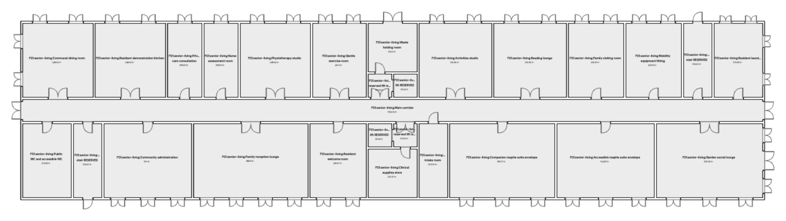

# Senior living

Case `senior-living` · Doors and windows v1.0

## 1. The building

- **Type:** Senior living
- **Floors:** 4
- **Rooms:** 68
- **Start:** Whole-building recorded BIM layout; zero starting openings; reserved vertical cores.
- **Data:** [`building.json`](building.json) has every room, core and access link, in metres. [`case.json`](case.json) lists the known limits of this building.

## 2. The request

> Add doors and windows to this senior-living.

This is all the agent gets. There is no answer key: no hidden door count, door type or swing.

## 3. What the agent made

- **111 doors** and **202 windows** on 4 floors.

*Ground floor plan of the finished model, in Snaptrude.*

<b>The agent's final message to the user</b>

I added **111 doors and 202 windows** across the four storeys of the senior-living building. Rooms are not furnished; you asked only for openings.

**What went in**
- **Room doors:** every room's door is on its corridor wall and swings into the room.
  - Dining rooms, lounges, studios, kitchens and the exercise and music rooms have 1.83 m pair doors.
  - Suites and smaller rooms have 0.91 m single doors.
- **Stairs:** each stair has a 60-minute fire door from the corridor that opens into the stair, the way people escape.
- **Lift cores:** each core has a 1.73 m pair door from the corridor into its lift lobby, and a 1.2 m sliding lift door. The store behind each core opens off that lobby.
- **Ground-floor outside doors, all opening outward:**
  - Pair doors at both corridor ends; I took the west end as the main entrance.
  - A fire exit straight outside from each stair.
  - Garden doors from the Garden social lounge.
  - A collection door from the waste holding room.
- **Windows:** casements that open outward.
  - Suites, lounges, dining rooms and studios have 1.45 × 1.83 m windows at a 600 mm sill, so seated residents can see out. They're spaced about one per 3 m of outside wall.
  - Laundries, the upper stairs and the corridor ends have smaller 1.22 × 1.52 m windows at a 900 mm sill.
  - Stores, plant rooms, the WC, lifts and lobbies have none.
- **Fixes:** I swapped the hinge side on 12 doors (8 lobby store doors and 4 west-stair doors) so they open cleanly against the walls.

**CA – circulation and access check**
- **Spine:** met. A double-loaded corridor with labelled lift lobbies; both stairs and both lift cores sit on the corridor.
- **Entrance:** not met. The entrance opens straight into the corridor end, because the plan has no entrance lobby. Fixing this needs your decision (see below).
- **Access:** the check says fail. All 28 ground-floor rooms are reachable from the 6 street doors, and every room has a door (0 without). The 81 upper-floor rooms can't be traced from the ground: no stairs are modelled yet, and each floor's stair room has a different name because the floor prefix is part of the label. Upper-floor reachability is therefore not verified.
- **Rooms entered through another room:** 8 stores open off their lift lobby.
- **Daylight:** met. 68 of 68 habitable rooms have an outside window.
- **Corridor width:** met. 2.21 m clear, against the 1.8 m I assumed for a care setting.
- **Dead ends:** about 6.4 m beyond each stair on the upper floors. That is over the 6 m limit, but within 15 m if the building is sprinklered (not confirmed).
- **Toilets:** the single "Public WC and accessible WC" room opens off the corridor. Separate men's, women's and accessible WCs inside it are not modelled, so not verified.
- **Service routes:** met. 0 service rooms lack access from circulation.
- **Exits:** met.
  - 2 stairs on every floor, about 60 m apart against a half-diagonal of about 37.5 m.
  - Both open straight outside on the ground floor.
  - That the stairs actually reach the ground is not verified: none are modelled yet.
- **Door swings:** met. I read the swing of all 111 doors.
  - 0 open into the corridor wrongly.
  - 15 open outward by exception: the electrical room, 6 exterior doors and 8 stair doors.
  - The 8 lift doors slide.
- **Model check:** 0 new findings. The 3 "no stair between storeys" findings were already there and stay until stairs are placed in the RESERVED stair rooms.

**BA – BIM authoring check**
- **Element types:** met. All openings are real door and window families; 0 masses stand in for any element.
- **Openings:** met. Each storey's doors went in as one batch and its windows as another; 0 windows open inward; 0 model check findings on openings.
- **Overlaps:** pass on all four storeys, with 0 clashes and 0 duplicates. The check found no pairs of openings close enough to need testing.
- **Not touched this turn:** walls, constructions, partitions, holes in slabs, structure, roof and furniture.

The 3D view failed to render; I captured the storey 2 plan instead, but the frame only shows the south row of rooms.

**Next steps you could ask for:**
1. Turn a ground-floor room by the west entrance into an entrance lobby, or move the main entrance to the south front through a new lobby.
2. Place the stairs in the RESERVED stair rooms, with openings through the floors.
3. Rename the stair and lift rooms the same on every floor, so access can be checked from the street to the top floor.
4. Furnish the suites, dining rooms and WC.
5. Apply finishes and clear glass.

## 4. The review

**Score: 7 / 10**

The opening task is substantially delivered across all occupied floors: 111 doors and 202 windows are present, all are wall-hosted, every room has at least one door, and the opening check reports no shared-rule findings. Real rework remains because most windows are outward-opening casements with 0.59 m sills—including upper-storey residential rooms—without evidence of restrictors or guarding, and the combined accessible/public WC entrance swings inward rather than providing the safer outward or sliding operation.

**Problems left that the automatic checks found:** 0

### What was right

- Complete whole-building coverage was provided on all four occupied storeys rather than only at ground level.
- The delivered counts agree with the agent’s account: 111 doors and 202 windows.
- All measured doors and windows are hosted in walls; every door bottom is at its storey floor level.
- The access check reports 109 rooms, with zero rooms lacking a door; ground-floor rooms are reachable and upper floors are only unverified because of the disclosed reserved-core starting-model limitation, which is not penalized here.
- All 202 windows are exterior-facing casements that open outward; no interior-facing daylight windows were found.
- Door dimensions are generous: measured nominal-width groups are approximately 1.03, 1.20, 1.84 and 1.94 m, with no undersized group found.
- All eight lift landing openings are sliding and nominally 1.20 m wide; the inspected family is the “Lift Landing Door – Centre Opening” version 1.
- Stair doors open into the stair, are nominally 1.029 m wide, and two inspected stair doors have a 60-minute fire rating.
- Room doors generally open into their served rooms rather than obstructing the corridor; the electrical-room door is the identified outward-opening exception.
- Plan captures of storeys 2–4 show consistent corridor-door and perimeter-window coverage throughout the long double-loaded floors.

### What was wrong

- A widespread low-sill condition remains: 176 windows have measured sills of about 0.59 m. For upper-storey senior residential suites, outward-opening casements at that height need documented restrictors, guarding, or an alternate safe window configuration; none was established.
- The WC door opens into the combined “Public WC and accessible WC.” For an accessible WC, an outward-opening or sliding entrance is preferable so a fallen occupant cannot block rescue access.
- Moving-leaf and sash sweep clearance was not established. The opening measurements explicitly state that no moving leaf or sash was swept, so this is not assessed rather than passed.
- The agent’s quoted 0.91 m and 1.83 m door sizes appear to describe authored leaf/type dimensions, while the measurements show nominal wall-opening widths around 1.03 m and 1.94 m. This is a convention difference, not fabrication, but the final report should have identified the reference used.

### Where it breaks the standard

| Rule | What happened | Evidence |
| --- | --- | --- |
| Windows must have sill heights and operation suitable and safe for the rooms they serve. | Most windows are outward-opening casements with approximately 0.59 m sills, including upper residential storeys, without verified restrictors or guarding. | Measured sill distribution: 176 windows at 0.59 m and 26 at 0.89 m; all 202 have operation casement and open outward. |
| Accessible toilet thresholds should use a suitable rescue-safe door operation. | The combined public/accessible WC entrance swings inward into the WC room. | Measurements for the WC door: sides are Main corridor and “F01:senior-living:Public WC and accessible WC”; it opens into the WC room; its nominal width is 1.029 m. |

### Measured evidence

Live measurements: storeys 1–4 contain 33/26/26/26 doors and 44/51/51/56 windows; all 313 openings have wall hosts, all 202 windows face outside and open toward "outside," and access reports 109 rooms, none without a door. Window measurements show 176 of 202 at a 0.59 m sill; the WC door serves “F01:senior-living:Public WC and accessible WC” and opens into that room, with a 1.029 m nominal width. The agent explicitly claimed: “Suites, lounges, dining rooms and studios have … windows at a 600 mm sill.”

The full review is in [`results/2026-11-15_v1.0/reviews/senior-living.json`](../../results/2026-11-15_v1.0/reviews/senior-living.json).

## 5. Self-fixes

The agent ran the automatic checks while it worked, and fixed what they found.

| Check | Found at first check | Left at last check |
| --- | --- | --- |
| Door opens against a wall | 4 | 0 |

---

Disagree with this score? [Open a score dispute](../../../../../../issues/new?template=dispute-score.yml).
