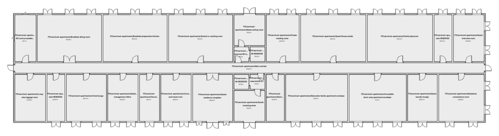

# Serviced apartments

Case `serviced-apartments` · Doors and windows v1.0

## 1. The building

- **Type:** Serviced apartments
- **Floors:** 5
- **Rooms:** 85
- **Start:** Whole-building recorded BIM layout; zero starting openings; reserved vertical cores.
- **Data:** [`building.json`](building.json) has every room, core and access link, in metres. [`case.json`](case.json) lists the known limits of this building.

## 2. The request

> Add doors and windows to this serviced-apartments.

This is all the agent gets. There is no answer key: no hidden door count, door type or swing.

## 3. What the agent made

- **136 doors** and **254 windows** on 5 floors.

*Ground floor plan of the finished model, in Snaptrude.*

<b>The agent's final message to the user</b>

I added **136 doors and 254 windows** across all five floors. Every room now has a door off the main corridor or a lift lobby, and every room people use for any length of time has windows on the facade. No furniture was added, since you didn't ask for it.

**Doors**
- **Ground floor entrances:** a 1.83 m pair door into Guest Residence Reception on the south facade. A second pair door leads from reception into the corridor, and there's a reception window on each side of the entrance.
- **Fire exits:** a fire-rated exit door at each end of the ground-floor corridor. Both stairs open onto the corridor, so each has a direct route out. These exit doors open outward, in the direction of escape.
- **Service rooms:** Goods Receiving and Waste Sorting each have an outside pair door. Inside, they're reached through the lift lobbies, as are the linen rooms on the upper floors. That keeps service traffic off the guest corridor.
- **Stairs:** each stair room has a 60-minute fire door from the corridor that opens into the stair.
- **Lifts:** 1.2 m centre-opening sliding landing doors face each lift lobby. Each lobby has a door from the corridor, set at the end away from the lift.
- **Apartments and rooms:** each apartment has an entrance door from the corridor; the accessible apartments and the public WC get 1.0 m doors. The dining and supper rooms get pair doors.
- **Swing:** every room door opens into its room, not into the 1.6 m corridor. Where a latch would have ended up against a side wall, I swapped the hinge side (26 doors).

**Windows**
- **Rooms:** 2-panel casements, 1.5 m high with a 0.9 m sill. Rooms get roughly one window per 3.2 m of facade, up to 1.5 m wide. Corner rooms also get windows on the end walls.
- **Other windows:** each stair has one window, the WC has a high awning window, and the upper corridors have a window at each end.
- **No windows:** stores, linen rooms, electrical, waste, roof maintenance, the luggage room and the lifts.

**Self-check**
- **CA:** all 28 ground-floor rooms are reachable from the entrances. On floors 2–5, all 27 rooms per floor have a door off the corridor or a lift lobby, and both stairs open onto the corridor. The check can't yet link the floors to each other: the stair rooms are still placeholders with no stairs in them, and their names change from floor to floor.
- **BA:** each floor's doors and windows were placed together in one go. Swing directions were read back, and none open the wrong way.
- **Model check:** the 10 lift-door width findings are fixed (widened to 1.2 m), and there are no new findings. The 4 "no stair between floors" findings were already there before this turn; they're the missing stairs.

The 3D view failed to capture, and the floor 2 plan only shows part of the floor, so I haven't checked the result visually.

**Possible next steps**
- Put real stairs into the West and East stair rooms on every floor. Give the stair rooms the same name on each floor at the same time, so the access check can confirm every apartment is reachable from the street.
- Lay out the inside of the apartments (bedroom, bathroom, kitchen partitions), then add their internal doors.
- Add an entrance canopy at reception and apply facade and glazing finishes.

## 4. The review

**Score: 9 / 10**

The opening work is comprehensive and technically sound across all five occupied storeys: 136 doors and 254 windows are present, every one is hosted, no room lacks a door, and all identified habitable rooms have exterior windows. Dimensions, operations, swing directions, hinge returns, sill heights and family functions satisfy the applicable standard; the only reservation is that moving-leaf collision clearance and a final visual review were not assessable, so this falls just short of unqualified sign-off.

**Problems left that the automatic checks found:** 0

### What was right

- Complete opening coverage on every occupied floor, with 136 doors and 254 windows matching the final claim.
- Every opening sits in a wall; no host-fit limitation was reported by the opening check.
- All 136 rooms have a door or circulation connection; the upper floors show as not linked to other floors, which concerns the disclosed reserved vertical cores and is outside this opening-only assessment.
- All 73 clearly habitable rooms identified from the room labels had an exterior window; all 254 windows face outside rather than another room or corridor.
- Door swing facts are coherent: ordinary room doors open into their rooms, stair doors open into the reserved stair rooms, final exits open outside, and lift doors are non-swinging.
- Widths are generous and suitable: ordinary, apartment, stair and corridor-exit doors are 1.029 m clear; accessible doors are 1.115 m; lift doors are 1.200 m; pair and entrance doors are 1.943 m.
- No single door had its hinge on the side away from the nearer wall, so the hinge sides are suitable.
- Window heights and sills are consistent: 252 windows are approximately 1.513 m high with ordinary sills approximately 0.894 m above each floor; the two WC awnings have approximately 1.518 m sills.
- Suitable families are present, including Single Flush Door v4, Lift Landing Door v1, Pair Flush Door v5, Casement Window v6 and Awning Window v8.
- The automatic opening check reported 136 doors, 254 windows and zero rule findings.

### What was wrong

- Moving-leaf and sash collision sweeps were not available from the opening check and therefore remain not assessed rather than passed.
- Both independent screenshots failed because of rendering errors, so visual inspection of facade rhythm and local opening composition was not possible.
- The agent’s intermediate statement of “32 doors and 43 windows” on storey 1 was superseded by the final correct total; the live model contains 45 ground-floor windows.

### Measured evidence

Live measurements found floor-by-floor coverage of 32/45, 26/52, 26/50, 26/51 and 26/56 doors/windows respectively; the access check reported 136 rooms, none without a door and none unreachable. All 390 openings had hosts; the model contains 10 sliding lift doors at 1.200 m clear, 10 stair doors at 1.029 m clear, a 1.943 m main entrance, no bad hinge returns, 254 exterior-facing windows, and no interior-facing windows. The agent accurately disclosed the remaining verification limitation: “The 3D view failed to capture… so I haven't checked the result visually.”

The full review is in [`results/2026-11-15_v1.0/reviews/serviced-apartments.json`](../../results/2026-11-15_v1.0/reviews/serviced-apartments.json).

## 5. Self-fixes

The agent ran the automatic checks while it worked, and fixed what they found.

| Check | Found at first check | Left at last check |
| --- | --- | --- |
| Lift doors slide and open onto a lobby | 10 | 0 |

---

Disagree with this score? [Open a score dispute](../../../../../../issues/new?template=dispute-score.yml).
