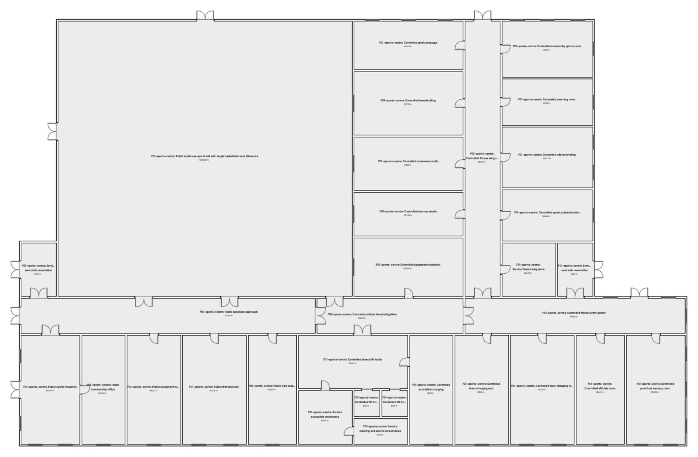

# Sports centre

Case `sports-centre` · Doors and windows v1.0

## 1. The building

- **Type:** Sports centre
- **Floors:** 3
- **Rooms:** 58
- **Start:** Whole-building recorded BIM layout; zero starting openings; reserved vertical cores.
- **Data:** [`building.json`](building.json) has every room, core and access link, in metres. [`case.json`](case.json) lists the known limits of this building.

## 2. The request

> Add doors and windows to this sports-centre.

This is all the agent gets. There is no answer key: no hidden door count, door type or swing.

## 3. What the agent made

- **101 doors** and **120 windows** on 3 floors.

*Ground floor plan of the finished model, in Snaptrude.*

<b>The agent's final message to the user</b>

I added **101 doors and 120 windows** across the three floors of the sports centre. Every room now has a door. The ground floor is fully connected from the entrances. The model check shows nothing new; its only findings are the two missing stairs, which were there before. No furniture was added, since you asked only for openings.

**Doors**
- **Entrances:** a main door into the reception on the west side, a public door at the west end of the spectator approach, a members' door at the east end of the fitness entry gallery, and an exit at the north end of the fitness wing spine. All are 6'-0" double doors that open outward.
- **Sports hall:** two double doors from the spectator approach, one from the athlete gallery, and two emergency exits in the west and north walls. All open out of the hall, as an assembly space needs.
- **Rooms:** 3'-3" single doors, each on the wall shared with the gallery, lobby or spine, opening into the room. The exceptions open outward: the accessible washrooms, accessible changing and the cleaning stores.
- **Corridor links:** double doors between the spectator approach, reception, athlete gallery, lift lobby, fitness entry gallery and spine on every floor.
- **Stair rooms:** 6'-0" double doors rated 60 min, opening into the stair. On the ground floor both stair rooms also have a door straight outside.
- **Lifts:** 3'-11" sliding landing doors onto the lift lobby.

**Windows**
- **Rooms and galleries on the outside walls:** fixed windows about 5'-0" × 5'-0", sill 3'-0", spaced along each facade.
- **Sports hall:** 8'-0" × 8'-0" high-level windows at a 24'-0" sill on the west and north walls.
- **Inner ground-floor studios:** the equipment induction, warm-up studio, movement studio and team briefing have no outside wall. Each got a window into the hall to borrow its light.

**Check card**
- **CA:** the access check passes on the ground floor (32 of 32 rooms reachable, all door swings correct). Upper floors: each of the 62 rooms has a door, but reachability can't be checked yet. That needs stairs, and the rooms are named differently on each floor ("F01-…", "F02-…").
- **Not met:** eight studios on floors 2 and 3 have no window. These are resistance training, free weights, functional training and conditioning on floor 2, and the dance, yoga, pilates and martial arts studios on floor 3. Their only wall that doesn't face the corridor is an upper-floor wall sitting right on top of the hall's full-height wall. The same applies to the court-edge galleries' view over the court. I held those 42 windows back because each would cut only one of the two overlapping walls.
- **Not met:** on floors 2 and 3 the fitness wing spine is a dead end about 98 ft long. Its stair is at the south end only, so fixing this means changing the plan, not adding a door.
- **Service rooms:** each cleaning and consumables store has no corridor wall, so it opens off the accessible washrooms next to it.
- **VC:** the stair rooms are still empty, so the stair checks can't see a way between floors. That is also why the upper floors can't be checked for reachability.
- **Clash check:** I didn't run it.

**Decision for you:** should I remove the upper-floor walls that sit on top of the hall's full-height walls (or cut the hall walls back)? Once that's done I can add the viewing windows for those eight studios and the court-edge galleries.

After that, I can place stairs in the two stair rooms and add a second escape from the north end of the upper spines. I can also apply facade and glazing finishes, or furnish the changing rooms, studios and café.

## 4. The review

**Score: 6 / 10**

The run delivered a substantial, functional opening package: 101 doors and 120 windows across three occupied storeys, with every opening hosted, every one of 94 rooms having a door, compliant measured door widths, suitable lift doors, and no swing-rule findings. However, daylight coverage remains materially incomplete across all floors: four ground-floor studios have only borrowed internal glazing, and eight upper-floor studios have no windows, requiring significant rework before the whole-building opening task is acceptable.

**Problems left that the automatic checks found:** 0

### What was right

- Exact final count claim verified: 101 doors and 120 windows.
- Whole-building coverage was attempted on all three occupied storeys rather than only the ground floor.
- All 221 openings returned a valid wall host.
- Every one of the 94 rooms has at least one door; ground-floor access reports all 32 rooms reachable.
- Opening measurements showed no undersized doors or incorrect room-to-circulation swings under the applicable rules.
- Single room doors measure 1.00 m nominal and 0.86 m clear; double doors measure about 1.94 m nominal.
- All six lift landing doors are sliding and approximately 1.20 m nominal, opening between lift reservations and shared lift lobbies.
- Window sill geometry is generally consistent: standard windows sit about 0.91 m above their storey floor, while the sports-hall clerestories are high level.
- The agent openly disclosed the eight unwindowed upper-floor studios instead of claiming complete daylight coverage.

### What was wrong

- Four occupied ground-floor rooms—Movement Studio, Team Briefing, Warmup Studio and Equipment Induction—received fixed glazing into the sports hall rather than exterior daylight; borrowed internal glazing does not satisfy the daylight principle.
- Eight occupied studios across floors 2 and 3 have no window: Conditioning, Free Weights, Functional Training, Resistance Training, Dance, Yoga, Pilates and Martial Arts.
- The sports hall's four room-facing windows are internal borrowed-light openings; its exterior clerestories are recorded on storey 2 because they occupy the tall hall wall, making floor-by-floor verification less clear.
- Upper-storey access remains unverified because all 62 upper rooms report not linked to other floors. This is contextual rather than penalized as missing stairs, but it prevents full end-to-end access verification.
- Moving-leaf and sash collision clearance was not assessed beyond the opening measurements; double-door leaf locations are explicitly estimated.
- Family-definition and instance fire-rating details could not be fully read, so the claimed 60-minute stair-door rating is not independently assessed.

### Where it breaks the standard

| Rule | What happened | Evidence |
| --- | --- | --- |
| Inspect and provide suitable doors and windows throughout every occupied storey. | Door coverage is complete, but window coverage is incomplete on every occupied floor. | Four ground-floor occupied rooms have only internal borrowed glazing, while four studios on floor 2 and four studios on floor 3 have no windows. |
| Habitable rooms should receive daylight through a window in an outside wall. | Twelve occupied rooms lack an exterior window; four use internal glazing into the sports hall and eight have no window. | Measured exterior-window room associations exclude the ground-floor Movement Studio, Team Briefing and Warmup Studio; access/window topology also lists eight named upper studios with no window. |

### Measured evidence

Live measurements found 41/30/30 doors and 37/46/37 windows on storeys 1/2/3; the access check reported 94 rooms, 0 without doors, 32 reachable and 62 not linked to other floors. The window review found no exterior window for the ground-floor Movement Studio, Team Briefing, Warmup Studio and sports hall, while Dance, Martial Arts, Pilates and Yoga on floor 3 and Conditioning, Free Weights, Functional Training and Resistance Training on floor 2 had no window at all. The agent acknowledged part of this incompleteness: “Not met: eight studios on floors 2 and 3 have no window.”

The full review is in [`results/2026-11-15_v1.0/reviews/sports-centre.json`](../../results/2026-11-15_v1.0/reviews/sports-centre.json).

## 5. Self-fixes

The agent ran the automatic checks while it worked, and fixed what they found.

| Check | Found at first check | Left at last check |
| --- | --- | --- |
| Door wide enough | 61 | 0 |

---

Disagree with this score? [Open a score dispute](../../../../../../issues/new?template=dispute-score.yml).
