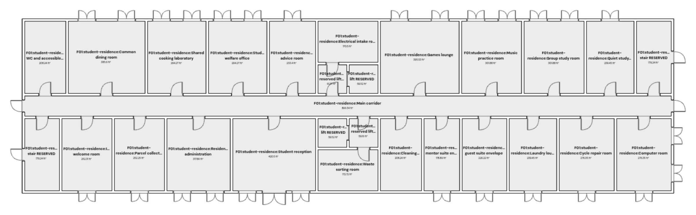

# Student residence

Case `student-residence` · Doors and windows v1.0

## 1. The building

- **Type:** Student residence
- **Floors:** 5
- **Rooms:** 85
- **Start:** Whole-building recorded BIM layout; zero starting openings; reserved vertical cores.
- **Data:** [`building.json`](building.json) has every room, core and access link, in metres. [`case.json`](case.json) lists the known limits of this building.

## 2. The request

> Add doors and windows to this student-residence.

This is all the agent gets. There is no answer key: no hidden door count, door type or swing.

## 3. What the agent made

- **136 doors** and **152 windows** on 5 floors.

*Ground floor plan of the finished model, in Snaptrude.*

<b>The agent's final message to the user</b>

Not furnished: none of the rooms has furniture or fixtures yet (study-bedrooms, kitchens, dining rooms, study rooms, offices, the WC). You asked for openings only.

I added doors and windows to all five floors of the residence: **136 doors and 152 windows**.

**Doors**
- **Rooms:** each room has one flush door (3'-0" × 7'-0", about 0.91 m) on its corridor wall, opening into the room. The rooms behind the lift cores (waste/recycling stores, electrical, data, mechanical, roof plant) open off their lift lobby.
- **Lifts:** each lift has a 1.2 m centre-opening sliding door onto its lobby, and each lobby has a door to the main corridor.
- **Stairs:** both stairs have a 60-min fire-rated door from the corridor on every floor, opening into the stair. On the ground floor each stair also has an exit door straight outside.
- **Entrances:** a 1.8 m pair door into Student reception on the long facade, plus a door at each end of the ground-floor corridor. All of them open outwards.

**Windows**
- 1.45 × 1.83 m (4'-9" × 6'-0") casements with a 0.9 m sill, about one for every 3.2 m of outside wall, all opening outwards.
- The corridor ends on floors 2–5 each have a smaller 1.22 × 1.52 m (4'-0" × 5'-0") window.
- Stores, plant rooms, the WC, lifts and stairs have no windows.

**What I fixed along the way**
- Two reception windows were too close to the entrance pair door, so I moved them away from it.
- Five doors had their hinge moved to the side away from a nearby wall.
- The Data service and Mechanical service doors now open inwards, so they don't swing into the small lift lobbies.

**CA — Circulation and access self-check** (walls and doors already built, checked from fresh read-backs)
- **Spine:** met. Double-loaded corridor; the corridor and the four lift lobbies are labelled spaces; stairs at both ends and lift cores in the middle all open onto it. The entrance is into Student reception, which leads to the corridor. No site is set, so which edge is the front isn't confirmed.
- **Access:** the check fails overall. Ground floor: 28 of 28 rooms reachable. Floors 2–5 (108 rooms) can't be linked because there are no stairs yet and the stair rooms are labelled per floor (F01…, F02…). Even so, every one of those rooms has a door straight onto the corridor or a lift lobby, confirmed from the door read-back. No room depends on another room for access.
- **Daylight:** met. Every habitable room is on an outside wall and has at least one window. No room is meant to be dark.
- **Widths:** met. Corridor is 1.6 m clear against a 1.5 m default (1.1 m minimum under IBC). It's the same width along its length. No doors swing into it and there are no columns.
- **Dead ends:** met. The longest is about 1.4 m, past the stair doors. There are no strips under 1.2 m.
- **Toilets:** not verified. "Public WC and accessible WC" is one room with its door off the corridor. The separate men's/women's/accessible compartments inside it aren't modelled.
- **Routes:** every service room has a door from a lobby, so that part is met. A separate service route is not met: there's no separate service corridor, because the existing plan uses one shared corridor. I didn't change the layout.
- **Egress:** two exits per floor (needed for sleeping use). The stairs are about 49 m apart, against half the plan diagonal of 26.8 m. On the ground floor both stairs have a door straight outside.
- **Doors:** 136 placed; I read which way each one opens and flipped 7 (5 hinge sides, 2 swings). Doors opening outward by exception: 5 exits, plus the electrical and roof-plant rooms (plant rooms) opening into their lobbies.
- **Fixed, not explained:** 0 findings open.
- **Finished:** 0 of 135 rooms furnished, as noted at the top.
- **Model check:** no new findings. The four "no stair between floors" notes were there before and stay until stairs are placed: the checks can't see stair families, so stairs have to be checked from their own settings once they're in.

**BA — BIM Authoring self-check**
- **Element types:** met. 136 doors and 152 windows exist as real door and window elements; nothing is modelled as a mass.
- **Openings:** met. Each floor's doors went in one batch and its windows in one batch. Every room has a door; every habitable room has an outside window; all 152 windows open outwards. The model check shows no "habitable room without window", "door swings into corridor" or "opening doesn't fit its wall" findings.
- **Checks:** clash check on each floor's doors and windows passed, 0 clashes and 0 probable duplicates. The access result is as in the access item above.
- **Stale sketches:** met, 0 leftover sketch spaces.
- **Not applicable this turn:** no conversion, partitions, slab openings, structure, roof or furniture.

The 3D view failed to render. A floor-2 plan only framed part of the floor; the visible part shows the room doors opening in from the corridor and windows along the facade. The model is set up in feet and inches, so the door and window sizes are in imperial with metric alongside.

**Next steps**
- Place stair families in the West and East stair rooms and add the openings through the floors for them. Then access can be checked across all five floors.
- Split the public WC into separate men's, women's and accessible toilets off a small lobby.
- Furnish one study-bedroom and copy it to the matching rooms, then do the kitchens, dining and study rooms.
- Apply facade and glazing finishes and view the building in Realistic mode.

## 4. The review

**Score: 9 / 10**

The opening task is comprehensively delivered across all five occupied storeys: 136 doors and 152 windows, every one hosted, no opening overlaps or host-containment failures, no doorless rooms, and no identified habitable room without an exterior window. The result falls just short of sign-off quality because upper floors mix two window-head heights, while moving-leaf clearance and exact instance family parameters could not be assessed.

**Problems left that the automatic checks found:** 0

### What was right

- Complete coverage on every occupied floor: doors/windows by storey are 32/27, 26/32, 26/31, 26/31 and 26/31.
- The access check contains 136 rooms and reports no room without a door; the 108 upper-floor rooms are only marked not linked to other floors because of the disclosed reserved-core starting-model limitation.
- All identified habitable uses had an exterior window: no missing daylight coverage was found on any of the five occupied storeys.
- All 288 openings are hosted; measured geometry found no openings outside host bounds and no same-wall opening overlaps.
- Doors stand at floor level on every storey. Windows consistently have approximately 0.908 m sills; standard windows are about 1.841 m high, with smaller corridor-end windows about 1.537 m high.
- Opening measurements show suitable special functions: lift doors are sliding and approximately 1.200 m nominal, the main entrance is a 1.943 m double-swing pair, and stair doors are approximately 1.029 m nominal.
- The automatic opening check of the whole model read 136 doors and 152 windows with zero findings, supporting correct swing directions, hinge arrangement, widths, outward-opening casements and fire-rating checks.
- The agent accurately disclosed the access limitation rather than claiming verified vertical circulation.

### What was wrong

- Storeys 2–5 use window heads at both approximately 2.444 m and 2.749 m. Although associated with intentionally smaller corridor-end windows, this misses the standard's preference for one coordinated head height per storey.
- Moving leaf and sash sweeps against nearby geometry were not assessed. The opening measurements state that many leaf positions are estimated, so this is an unchecked item rather than a defect.
- The exact settings of the placed doors and windows could not be read; family suitability is therefore supported by operation and geometry facts rather than a complete instance-definition audit.

### Where it breaks the standard

| Rule | What happened | Evidence |
| --- | --- | --- |
| Window heads should be coordinated at one height per storey. | Upper storeys contain both standard-height and smaller corridor-end windows with different head levels. | Measured head range on each of storeys 2–5: 2.444–2.749 m. |

### Measured evidence

Live measurements found floor-by-floor opening totals of 59, 58, 57, 57 and 57; all 288 openings had hosts, with zero bbox host-containment failures and zero same-host overlaps. Window heads on storeys 2–5 range from 2.444 m to 2.749 m, rather than maintaining one head height per storey.

The full review is in [`results/2026-11-15_v1.0/reviews/student-residence.json`](../../results/2026-11-15_v1.0/reviews/student-residence.json).

## 5. Self-fixes

The agent ran the automatic checks while it worked, and fixed what they found.

| Check | Found at first check | Left at last check |
| --- | --- | --- |
| Door does not swing into a corridor | 2 | 0 |

---

Disagree with this score? [Open a score dispute](../../../../../../issues/new?template=dispute-score.yml).
