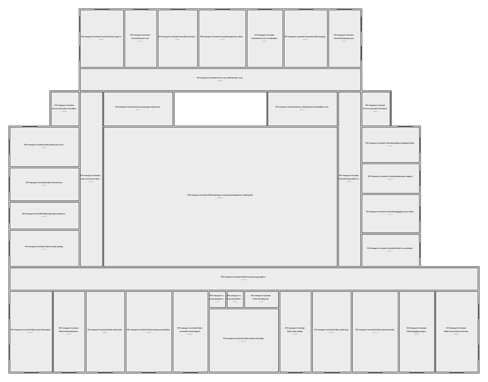

# Transport terminal

Case `transport-terminal` · Doors and windows v1.0

## 1. The building

- **Type:** Transport terminal
- **Floors:** 3
- **Rooms:** 76
- **Start:** Whole-building recorded BIM layout; zero starting openings; reserved vertical cores.
- **Data:** [`building.json`](building.json) has every room, core and access link, in metres. [`case.json`](case.json) lists the known limits of this building.

## 2. The request

> Add doors and windows to this transport-terminal.

This is all the agent gets. There is no answer key: no hidden door count, door type or swing.

## 3. What the agent made

- **74 doors** and **104 windows** on 3 floors.

*Ground floor plan of the finished model, in Snaptrude: windows, but no doors. The agent added no doors on this floor; see the review.*

<b>The agent's final message to the user</b>

**Floors 2 and 3 have all their doors and windows. The ground floor has its 35 windows but none of its 51 doors yet,** because of a defect in the ground slab (below). No room is furnished: furniture wasn't part of this request.

**What's in the model**

| Floor | Doors | Windows | Rooms with a door |
|---|---|---|---|
| 1 – Arrival and ground concourse | 0 (51 planned) | 35 | 0 of 38 |
| 2 – Passenger amenities | 37 | 34 | 37 of 37 |
| 3 – Operations and staff | 37 | 35 | 37 of 37 |

- **Circulation:** every room's door opens off the front gallery, the west or east side route, the rear staff route or a lift lobby. Controlled rooms open onto the controlled staff routes, and the passenger washrooms open onto the public west route.
- **Door types:** public rooms have 1.83 m double flush doors. Staff and service rooms have single flush doors, which I widened to 1.0 m after the check found them 0.77 m clear, under the 0.80 m a room door needs. The model check now reports no new findings. The gallery, routes, lobbies and lobby links are joined to each other with double doors.
- **Lifts:** lifts A and B have 1.2 m centre-opening sliding doors onto the shared lift lobby on each floor.
- **Stairs:** both stair rooms have 60-minute fire-rated double doors from the side routes.
- **Windows:** 2.4 × 1.8 m fixed three-panel windows with a 0.9 m sill, in every outside wall of the rooms people use for long stretches.

**Ground floor, not done.** The ground slab's geometry is broken. Every door at floor level touches that slab, and the clearance check can't test against it, so it refuses all of them. You agreed to replacing the slab, but a new slab couldn't be built from the ground-floor outline, so I put the original back unchanged. The 51 doors are still planned and ready to place, already at the new 1.0 m width:
- the main entrance: a 5.4 m automatic sliding glass entrance into the entrance lift lobby
- two entrances at the ends of the gallery and two service entrances at the ends of the rear staff route
- a fire-rated exit door to the outside from each stair
- three double doors from the gallery into the concourse, plus all the room doors

**CA – Circulation and access** (BIM stage)
- **Spine:** met. A single-loaded front gallery with side routes and a rear staff route, all labelled spaces; the lift core sits on the gallery. The entrance into the front lobby is planned, not placed.
- **Access:** not verified. There are no street doors yet, so reachability can't be traced. Floors 2 and 3 have a door in every room (74 of 74); the ground floor has 0 of 38.
- **Daylight:** met. Every habitable room on an outside wall has at least one window (104 placed). None is internal.
- **Widths:** the gallery and routes are 3.8 m, measured from their floor plates, against a 1.8 m assembly-use target (assumed). Nothing stands in them.
- **Dead ends:** not met, and this comes from the existing plan. On floors 2 and 3 the gallery runs about 12 m past the west route and about 20 m past the east route with no exit, over the 6 m limit (15 m if sprinklered).
- **Toilets:** met. The washrooms open off the west route. The separate men's, women's and accessible rooms inside them aren't modelled.
- **Routes:** met. The rear service route is continuous and serves the cleaning rooms; no service room lacks service access.
- **Egress:** the two stairs are 53 m apart, against half the plan diagonal of 50.5 m, so they count as two real exits. Their ground-floor exits to the outside are planned but not placed. No stairs are modelled in the stair rooms yet, so the floors aren't connected vertically.
- **Doors:** 74 placed; which way each opens was read for all 74, and none swings into a corridor (0 flipped). Stair doors open into the stair, as escape doors should.
- **Open findings:** the ground-floor doors (blocked by the slab) and the gallery dead ends (needs a plan decision from you).
- **Not furnished:** every room, as noted above.
- **Model check:** no new findings after the width fix. The 5 findings that were already in the model before this turn are unchanged.

**BA – BIM Authoring**
- **Element types:** met. Every opening is a hosted door or window family; no masses were used.
- **Openings:** each floor's doors and windows went in as one batch per floor; width findings fixed (40 doors widened, 0 open).
- **Conversion, constructions, partitions, voids, structure, roof:** nothing of these kinds was built this turn.
- **Checks:** the access check is not verified (no street doors yet). The clash check was not run on the 178 new openings.
- **Slab:** the ground slab is unchanged, so the defect that blocks its doors is still there.

**Next steps**
1. Redraw the ground slab by hand over the ground-floor outline, or let me try a simpler rectangular slab. Then I'll place the 51 ground-floor doors and run the full access check from the street.
2. Fix the gallery dead ends on floors 2 and 3, for example with exit stairs at both gallery ends.
3. Add stairs in the east and west stair rooms, then fit out the washrooms, waiting areas and offices.

## 4. The review

**Score: 5 / 10**

The run delivered a substantial, generally competent opening package on storeys 2 and 3 and windows throughout, but the entire occupied ground floor remains without doors or an exterior entrance. Under the doors and windows standard, a whole use group/storey with no access is Blocking, so the result cannot score above 5 despite the sound upper-floor work.

**Problems left that the automatic checks found:** 0

### What was right

- All 178 delivered openings are hosted in walls; no unhosted openings were measured.
- Storeys 2 and 3 each have doors serving all 37 rooms, with coherent room-to-circulation topology.
- The automatic checks and a new opening check found no swing, hinge, width, lift-door, or sash-rule findings among the delivered openings.
- Single room doors measure 1.00 m nominal and 0.86 m clear after repair; double doors measure about 1.94 m nominal, while lift landing doors are sliding and 1.20 m wide.
- The two lift reservations on each upper floor use the “Lift Landing Door – Centre Opening” family, version 1, opening onto shared lift lobbies.
- Upper stair-reservation doors use “Pair Flush Door,” version 5, with a 60-minute fire rating; opening measurements show they open into the stair reservations.
- All 104 windows face outside and are hosted. Their measured width is about 2.413 m, height about 1.813 m, with consistent approximately 0.894 m sill height relative to each storey.
- The agent was candid about the incomplete ground floor and did not claim whole-building access was complete.

### What was wrong

- Blocking: all 38 occupied ground-floor rooms have no door, including offices, waiting areas, retail, café seating, passenger support rooms, service rooms, circulation spaces, and both reserved stair zones.
- There is no ground-floor exterior entrance or final exit door, so the transport terminal cannot be entered or used as delivered.
- The opening task is incomplete across the building: the agent described 51 planned ground-floor doors but delivered none of them.
- Whole-building reachability remains unverified; the live access result is "unverified" with 38 no-door rooms and 74 upper-floor rooms reported as not linked to other floors because no valid ground entrance exists.
- Moving-leaf collision sweeps and a complete clash check were not established, so those aspects are not assessed rather than passed.

### Where it breaks the standard

| Rule | What happened | Evidence |
| --- | --- | --- |
| Add doors and windows to this transport-terminal as a whole-building task. | Windows were added throughout and doors were added only on storeys 2 and 3; the entire occupied ground floor has no doors. | Live opening counts are storey 1: 0 doors/35 windows; storey 2: 37/34; storey 3: 37/35. The access check reports 38 ground-floor rooms with no door. |
| Every occupied storey and room-use group must have door coverage and room-to-circulation access. | Ground-floor public, controlled, service, circulation, lift-reservation, and stair-reservation spaces all lack doors. | The access check summary: 112 rooms, 38 with no door; no room on the ground floor has a door. |
| The building must have a usable public entrance and appropriate exits. | No delivered ground-floor door connects the terminal to outside. | The opening check found zero doors on storey 1 and no outside-facing doors anywhere in the delivered set. |

### Measured evidence

Live measurements found 178 openings: storey 1 has 0 doors and 35 windows, storey 2 has 37 doors and 34 windows, and storey 3 has 37 doors and 35 windows. The access check reported 112 rooms total, including 38 ground-floor rooms with no door; the agent accurately disclosed: “The ground floor has its 35 windows but none of its 51 doors yet.”

The full review is in [`results/2026-11-15_v1.0/reviews/transport-terminal.json`](../../results/2026-11-15_v1.0/reviews/transport-terminal.json).

## 5. Self-fixes

The agent's checks found no door problems to fix while it worked.

---

Disagree with this score? [Open a score dispute](../../../../../../issues/new?template=dispute-score.yml).
